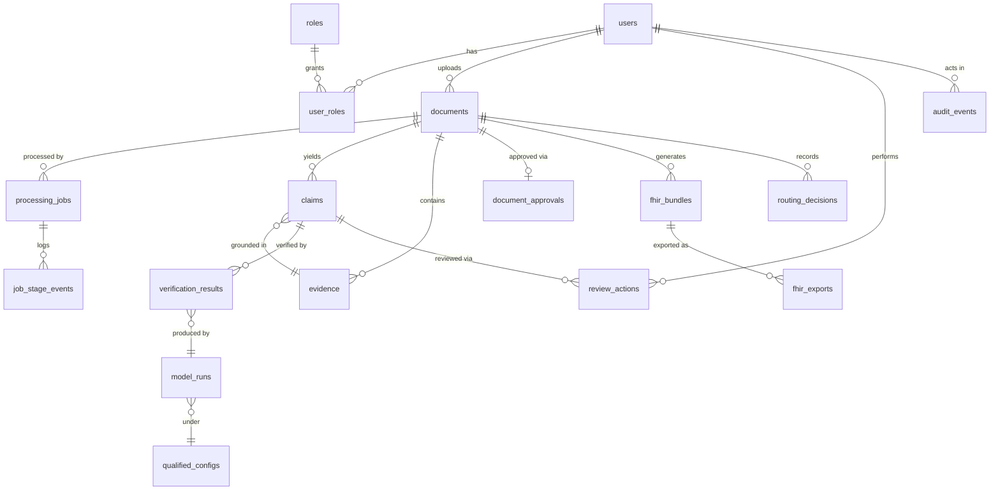
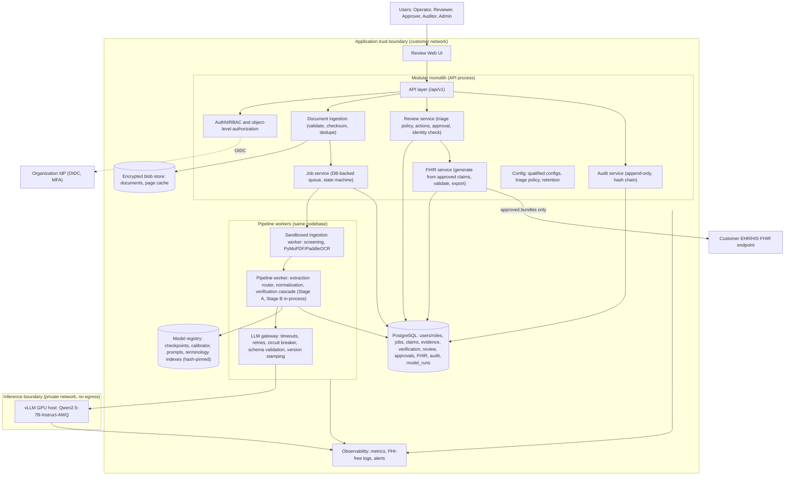

# PRODUCTIZATION_SPEC.md
## Productization Specification: Evidence-Grounded Clinical Document Verification and Review Platform

**Status:** PROPOSED. Planning document pending owner approval. No part of this document has been implemented.
**Version:** 0.1 (draft)
**Date:** 2026-10-03
**Relationship to other documents:** This document **extends** [`PROJECT_SPEC.md`](PROJECT_SPEC.md). It does not replace or relax it. Where the two documents conflict about the research/ML pipeline, `PROJECT_SPEC.md` wins. Where this document introduces new requirements (users, storage, security, review workflow, deployment), it is authoritative for the productization work only. Decisions are recorded in [`PRODUCTIZATION_DECISIONS.md`](PRODUCTIZATION_DECISIONS.md) using IDs `PD-NNN`.
**Numerical authority:** All measured results cited here come from `experiments/FINAL_REPORT_DATA_SHEET.md`. Statements about completion status come from `experiments/FINAL_PROJECT_RECONCILIATION_AUDIT.md`. Numbers marked **(derived)** are simple arithmetic on those figures and are not new measurements.

### 0.1 Requirement language

Same meaning as `PROJECT_SPEC.md` §0.1: **MUST / MUST NOT** (non-negotiable), **SHOULD** (strong default), **MAY** (optional), **OPEN** (decision not made; an implementer MUST stop and get it resolved rather than choosing silently).

### 0.2 Framing and non-claims (read first)

1. The current system is an **academic/research prototype**. It is not clinically validated, not clinically safe by demonstration, not production-ready, and not compliant with any healthcare regulation or privacy law.
2. Everything measured so far was measured on a **synthetic/semi-synthetic benchmark** (120 documents, 5,629 claims). The n2c2 real-data slice is feasibility-gated and was not executed. No result in this document should be read as a real-world performance estimate.
3. The verification cascade establishes **document-evidence fidelity** (does the structured claim match the source text). It does not establish clinical correctness. A document can itself be wrong, and a claim that faithfully matches a wrong document is `SUPPORTED`.
4. Implementing security controls does not make the product compliant with HIPAA, DPDP, or any other regime. Compliance is an organizational and legal outcome (Section 6).
5. This specification must not be used to justify any claim of clinical decision support, diagnosis, treatment recommendation, or clinical safety. `PROJECT_SPEC.md` §3 and §28 remain in force.

### 0.3 Product statement

> A self-hosted **document-to-FHIR conversion workbench** in which an AI pipeline proposes structured clinical claims from scanned or born-digital documents, an evidence-grounded verification cascade flags where those claims disagree with the source, and trained staff review and approve claims before FHIR output is exported. Every output is traceable to a source span, a verification verdict, a model/prompt version, and a named human decision.

The product's value is **reducing and focusing human review effort while keeping a complete evidence trail**. It is not "automatic EHR population". The differentiator is the verification layer and audit trail (the project's research contribution), not extraction.

---

## 1. Users, Stakeholders, and Customer

### 1.1 Customer organization (assumption, see OPEN-01)

The most plausible first customer is an organization that **already digitizes paper or PDF clinical documents into a structured record**:

- a hospital or hospital group's Medical Records / Health Information Management (HIM) department;
- a diagnostic laboratory network that wants lab reports in FHIR form;
- a health-data operations vendor or digital-health company doing document digitization for providers.

The customer organization is expected to be the **data fiduciary/controller** for patient data. The product operator (vendor or internal IT) acts as a **processor** where applicable (see Section 6).

### 1.2 Roles

| Role | Type | Who | What they do | System permissions (summary) |
|---|---|---|---|---|
| **Document Operator** | **Primary** | HIM/medical-records staff | Uploads documents, selects/confirms patient context, monitors job status, handles failed documents | Upload; view own/team jobs; view job status; no approval |
| **Clinical Data Reviewer** | **Primary** | Trained records staff, possibly nurse/clinician depending on org policy | Reviews flagged claims against the source evidence, accepts/edits/rejects, confirms patient identity | View assigned documents and claims; review actions; no config access |
| **Approver** | Secondary | Senior reviewer / HIM supervisor (can be the same person as Reviewer if org policy allows) | Approves a fully reviewed document for export; second-review of escalated claims | Approve/reject documents; view audit for their scope |
| **System Administrator** | Secondary | Healthcare IT admin | Users/roles via IdP mapping, system configuration, health monitoring, retention jobs | Configuration and operations; **no default access to document content (PHI)** |
| **Auditor / Quality Officer** | Secondary | Compliance / quality team | Reads audit trail, review statistics, override rates, QA sampling results | Read-only audit and metrics; document content access only via explicit, logged request |
| **Integration Service Account** | System | EHR/HIS integration team (non-human) | Receives or pulls approved FHIR bundles | Scoped API credentials; export endpoints only |
| **ML/Model Steward** | Secondary (internal) | Project/vendor ML engineer | Qualifies model/prompt/config changes; reviews drift metrics | Model registry and metrics; no PHI access by default |

Separation of duties: Administrators MUST NOT hold Reviewer or Approver roles by default. The Document Operator who uploaded a document SHOULD NOT be the sole approver of that document (configurable; see PD-009).

### 1.3 Not assumed to be users

- **Patients**: no patient-facing features.
- **Treating clinicians as direct users**: out of scope. Clinicians consume data downstream in the EHR; they do not use this tool to make decisions.
- **Third-party payers, researchers**: out of scope.

### 1.4 System integrations (target state)

| Integration | Direction | Initial scope | Notes |
|---|---|---|---|
| Organization identity provider (OIDC) | Inbound auth | MUST (target) | Avoids building a credential store; see PD-006 |
| EHR/HIS via FHIR R4/R4B API | Outbound | Phase 8.8 | Start with file export, then FHIR transaction push to a test server |
| Patient identity source (MPI/HIS patient lookup) | Inbound read | OPEN-06 | Needed to avoid wrong-patient association |
| Document sources (scanner share, PACS/DMS, email) | Inbound | **Out of scope initially** | Manual/API upload only |
| GPU inference node (vLLM) | Internal | MUST | Separate machine for hardware reasons |
| Observability stack | Outbound | Phase 8.10 | Metrics/log shipping without PHI |

### 1.5 Workflow from the primary user's perspective

A Document Operator drops a batch of scanned lab reports into the tool and confirms which patient/encounter they belong to. They go to other work. The system processes the documents. A Reviewer later opens a queue ordered by risk: documents with disagreements first. For each flagged claim the reviewer sees the source page with the evidence highlighted next to the extracted value and the verifier's finding, fixes or rejects what is wrong, and confirms the patient identity. An Approver signs off. Approved data is exported as FHIR to the organization's system. An Auditor can later reconstruct, for any exported value, what the source said, what the AI proposed, what the verifier concluded, which model version ran, and who approved it.

The reviewer never sees the words "Qwen", "ModernBERT", or "cascade stage" as concepts they must understand. They see "Needs review: value differs from source" and, on demand, "How was this checked?" (Section 7.4).

---

## 2. End-to-End Workflow

Each step lists actor, system action, input, output, failure, and whether a human is required. Failure behavior is detailed in Section 13.

| ID | Step | Actor | System action | Input | Output | Primary failure modes | Human needed? |
|---|---|---|---|---|---|---|---|
| W-01 | **Upload** | Document Operator (or integration account) | Authenticate; validate size/type/page limits; compute SHA-256; store encrypted blob; create `documents` row; check duplicate | File + patient context hint | `document_id`, state `UPLOADED` | Too large/wrong type; duplicate hash; storage failure; unauthorized | Yes (operator initiates; resolves duplicates) |
| W-02 | **Safety screening** | System | Type sniffing, structure checks, optional AV scan, in a sandboxed worker | Stored blob | `SCREENED` or `QUARANTINED` | Malformed/malicious file; parser crash/timeout | Only on quarantine |
| W-03 | **Ingestion / OCR** | System (existing pipeline) | Born-digital text extraction or OCR; produce `DocumentText` (schema §7.1) with token bboxes and OCR confidence | Blob | `DocumentText` | Unreadable/empty doc; OCR engine failure; very low OCR confidence | Only on failure or low-quality flag |
| W-04 | **Extraction** | System (existing router, §11) | Region classification, deterministic/GLiNER extraction, narrative extraction via LLM gateway; evidence-substring check | `DocumentText` | `Claim[]`, `Evidence[]`, `RoutingDecision[]` | Zero claims; LLM unavailable for narrative regions; span hallucination discards | If zero claims or narrative not processed |
| W-05 | **Normalization** | System (existing, §14) | LOINC/RxNorm/UCUM retrieval; null code below threshold | `Claim[]` | Enriched `Claim[]` | Below-threshold code (expected, not a failure) | Reviewer sees uncoded items |
| W-06 | **Verification** | System (existing cascade, §12) | Stage A, Stage B, Stage C only on escalation | `(Claim, Evidence)` | `VerificationResult[]` | ModernBERT unavailable; Qwen unavailable/malformed; | Depends on result and policy (Section 7) |
| W-07 | **Triage** | System | Apply versioned triage policy to assign each claim a review requirement and priority | Verification results + policy | Claim review states; document `READY_FOR_REVIEW` | Policy misconfiguration | No |
| W-08 | **Patient identity check** | System then Reviewer | Compare extracted header demographics with the selected patient context; flag mismatch | Header claims + patient context | `identity_check` result | Mismatch; missing header; ambiguous | **Yes. Always required before approval** |
| W-09 | **Human review** | Reviewer | See Section 7: accept / edit / reject / escalate each required claim | Review task | Review actions; edited claims are re-verified | Reviewer disagrees with verifier; evidence wrong; document unreadable | **Yes** |
| W-10 | **Approval / rejection** | Approver | Approve document when all required claims resolved and identity confirmed; or reject whole document | Reviewed document | `APPROVED` / `REJECTED` | Unresolved claims block approval | **Yes** |
| W-11 | **FHIR generation** | System | Generate R4B Bundle **from approved claims only**, with provenance extensions; schema-validate | Approved claims | `fhir_bundles` row, validation report | Validation failure (should be impossible if mapping is correct; treated as defect) | No (alert on failure) |
| W-12 | **Export / integration** | System (or Approver triggers) | Deliver bundle via configured channel (file download, then FHIR API push); idempotent | Bundle | `fhir_exports` row | Target unavailable; auth failure; partial failure | Operator on persistent failure |
| W-13 | **Audit / history** | System; Auditor reads | Append-only audit events for every state change and access; query UI/API | All events | Audit trail | Audit write failure (MUST fail the action; see PD-012) | Auditor for review |
| W-14 | **Retention / deletion** | System (policy); Admin configures | Apply retention classes; purge; legal hold | Policy | Tombstones, deletion log | Deletion failure; backup residue | Admin on failure |

Job state machine (document level):

```
UPLOADED -> SCREENED -> INGESTED -> EXTRACTED -> NORMALIZED -> VERIFIED
   |            |           |            |                        |
QUARANTINED  FAILED_INGEST  NEEDS_ATTENTION (zero claims / narrative not processed)
                                                                  v
                    AWAITING_LLM (Qwen unavailable) --timeout or recovery--> READY_FOR_REVIEW
                                                                  v
                                              IN_REVIEW -> REVIEWED -> APPROVED -> EXPORT_PENDING -> EXPORTED
                                                  |                        |
                                              REJECTED                EXPORT_FAILED (retryable)
```

Claim-level review states: `PENDING_REVIEW`, `PRE_ACCEPTED` (policy-permitted only), `ACCEPTED`, `EDITED`, `REJECTED`, `ESCALATED`. Terminal states are `ACCEPTED`, `EDITED`, `REJECTED`.

---

## 3. LLM Architecture (Qwen as an internal component)

### 3.1 Principles

1. The LLM is an **internal model component**. It does not appear in user vocabulary, API contracts, or permissions.
2. All LLM access goes through one **LLM Gateway** module. No other module imports an HTTP client for model calls.
3. The production path uses a **self-hosted** model server inside the organization's trust boundary. Public/hosted LLM APIs MUST NOT receive PHI.
4. The `Mock` implementation is a test/development tool. It MUST be impossible to run it in a production profile without a loud, audited failure (PD-003).
5. The LLM is never the sole source of truth (`PROJECT_SPEC.md` §4.2). Output is schema-validated; extraction output is also evidence-substring-validated.

### 3.2 What exists today (verified in code)

| Aspect | Current state |
|---|---|
| Extraction provider protocol | `extract/llm_extractor.py`: `LLMProvider.complete(system_prompt, user_prompt) -> str`; implementations `VLLMProvider` (timeout 60 s, API key from env var, `json_schema` strict response format) and `MockLLMProvider` |
| Judge client protocol | `verify/stage_c.py`: `LLMClientProtocol.generate(prompt, schema) -> str`; implementations `VLLMJudgeClient` (timeout 30 s, seed 42, temperature 0.0, max_tokens 256) and `DefaultMockLLMJudge` |
| Duplication | **Two parallel abstractions** with different method names, timeouts, key handling, and retry counts (router `max_llm_retries=2`; judge `max_attempts=3`) |
| Stage C failure | After bounded retries returns `INSUFFICIENT_EVIDENCE`, confidence 0.50, `is_fallback=True`, error text embedded in `rationale` |
| Versioning | `StageCResult` carries `model_name` and `prompt_version` (`STAGE_C_PROMPT_VERSION`); judge system prompt text lives in code |
| Defaults | `StageCJudge()` with no client defaults to `DefaultMockLLMJudge`; `LearnedVerifier()` with no model path falls back to a **heuristic** predictor (logged as a warning only); `VerificationCascade()` constructs both defaults |
| Experimental serving | vLLM on Colab T4, reached via tunnel. Experimental only |

> **Consequence (important):** the default `clindoc process` command does **not** execute the benchmarked configuration. The measured cascade results came from explicitly configured runs (ModernBERT checkpoint, calibrated temperature, vLLM-served Qwen2.5-7B-Instruct-AWQ, Prompt V1). Productization therefore MUST introduce an explicit, fail-closed production profile (Sections 3.6, 10, PD-003, PD-004). This is a design requirement, not a criticism of the research pipeline, which is explicitly allowed to use mocks for tests (DEC-006).

### 3.3 Target design: LLM Gateway

A single internal interface wraps the two existing call shapes via thin adapters, so the research code and its measured behavior are not rewritten:

```
Stage C judge  --(generate)-->  GatewayJudgeAdapter  \
                                                       >--  LLMGateway.complete_structured(
Narrative extractor --(complete)--> GatewayExtractAdapter /        role, system_prompt_id, user_prompt, json_schema, policy)
                                                              --> ProviderBackend
                                                                    |- VLLMBackend   (production)
                                                                    |- MockBackend   (dev/test only)
```

Gateway responsibilities (MUST):

- enforce role-specific policy (see 3.5);
- inject model/prompt identity into every response record (3.7);
- validate JSON against the schema (`StageCJudgeOutput`, extraction schema) and **reject, never repair**;
- enforce timeouts, bounded retries, concurrency limits, and circuit breaker (3.5);
- never log prompts or responses by default (PHI); log only IDs, sizes, latency, outcome, hashes;
- refuse to start in a `production` profile if the backend is `MockBackend` or the endpoint is not on the allowlisted internal address.

The adapters MUST preserve existing prompt text byte-for-byte for the qualified prompt versions. Any prompt text change is a new prompt version that invalidates the measured results until re-evaluated (3.8).

### 3.4 Production Qwen path

- **Model:** `Qwen/Qwen2.5-7B-Instruct-AWQ` (4-bit AWQ), as in the audit (DEC-006). License terms MUST be reviewed before commercial use (OPEN-10).
- **Serving:** vLLM OpenAI-compatible server on a dedicated GPU host inside the organization's network. Not reachable from the public internet.
- **Decoding:** `temperature=0.0`, `seed=42`, `max_tokens=256`, `response_format=json_schema (strict)` as in the audited runs. Bitwise reproducibility across different GPUs or vLLM versions is **not guaranteed**; the qualified configuration records the serving stack (3.8).
- **Network:** TLS to the endpoint; authenticated (bearer token or mTLS); the gateway is the only client; egress from the GPU host denied by default.
- **Capacity (derived estimate, not a real-document measurement):** the audited cascade run took 1,598.59 s for 1,826 claims with 381 escalations, i.e. up to about 4.2 s per escalated claim including non-LLM time. At the synthetic benchmark's shape (about 54 claims and about 11 escalations per document), that is on the order of tens of seconds of LLM time per document. Real documents will differ. Sizing MUST be established by a load test (Phase 8.7). The product has no low-latency requirement (`PROJECT_SPEC.md` §3), so asynchronous batch processing is appropriate.

### 3.5 Configuration, timeouts, retries, failure handling

| Setting | Default (from audited code) | Production requirement |
|---|---|---|
| Judge timeout | 30 s | Configurable; SHOULD start at 30 s, tune with load test |
| Extraction timeout | 60 s | Configurable |
| Judge attempts | 3 total (DEC-013: max 2 retries) | Keep; retries only for transport errors and schema/parse failures |
| Extraction retries | 2 | Keep |
| Backoff | none in code | MUST add exponential backoff with jitter between attempts |
| Concurrency | none | MUST cap concurrent requests (value set by load test) |
| Circuit breaker | none | MUST open after N consecutive failures; half-open probe; N and cool-down configurable |
| Idempotency | n/a | A retried judge call for the same `(claim_id, prompt_version, model_revision)` MUST NOT produce two verification records |

**If Qwen is unavailable (production behavior, MUST):**

1. The cascade MUST NOT silently convert the failure into a normal `INSUFFICIENT_EVIDENCE` verdict and proceed. The current code's fallback verdict is indistinguishable by label from a genuine `INSUFFICIENT_EVIDENCE`. Production MUST persist `is_fallback=true` and a machine-readable reason (`llm_unavailable`, `llm_timeout`, `llm_schema_invalid`) and MUST surface it in the audit record and the reviewer UI.
2. Escalated claims enter state `AWAITING_LLM`; the job is retried when the circuit closes.
3. If recovery does not occur within an organization-set window, those claims go to **human review** with reason `llm_unavailable`, showing the available Stage A and Stage B labels. They MUST NOT be pre-accepted and MUST NOT be exported without human action.
4. Claims that Stage A/B resolved without escalation are unaffected (graceful degradation).
5. For narrative regions, if the LLM extractor is unavailable the document is marked `narrative_not_processed` (needs attention). The system MUST NOT substitute `MockBackend` output.
6. Operators see a plain-language status ("Automated second check unavailable; flagged for manual review"). They do not see model names.

### 3.6 What MockLLM is and is not

**What it is.** `MockLLMProvider` (extraction) and `DefaultMockLLMJudge` (judge) are deterministic, rule-based stand-ins that return schema-valid JSON. The extraction mock uses regex heuristics over a small vocabulary. The judge mock chooses a verdict from keywords in the prompt text. They exist so unit tests, CI, and offline development run fast and deterministically without a GPU server (DEC-006).

**What it is not.**
- It is not an LLM and has no clinical or linguistic competence.
- It is not a proxy for Qwen's quality. **E3's metrics (micro-F1 0.2382, macro-F1 0.2047) measure the mock's heuristics, not production narrative extraction**, which is why E3 is "COMPLETE WITH DOCUMENTED LIMITATION".
- It is not a fallback for outages (3.5).
- It is not acceptable in any production profile, any demo shown as a product capability, or any evaluation reported as a model result.

**Controls (MUST):** (a) production profile refuses to boot with a mock backend; (b) every result records `provider_kind` (`vllm | mock | heuristic`); (c) export is blocked for any claim whose verification or extraction record has `provider_kind != vllm` (for LLM roles) or a heuristic Stage B; (d) test fixtures are the only code paths that construct mock backends.

The same rule applies to the Stage B heuristic fallback (`_heuristic_logits`) and `MockModelPredictor`: **dev/test only, never silent in production** (PD-004).

### 3.7 Model and prompt version tracking

Every `VerificationResult` and every LLM-extracted `Claim` MUST link to a `model_runs` record containing:

`component`, `provider_kind`, `model_name`, `model_revision_hash`, `quantization`, `serving_engine` and version, `prompt_id`, `prompt_version`, `prompt_sha256`, `schema_version`, decoding parameters (temperature, seed, max_tokens), `calibrator_id/version` (Stage B temperature; Stage C calibrator), `qualified_config_id`.

### 3.8 Qualified configuration

Measured results hold only for the exact configuration that produced them. The product MUST define a **qualified configuration manifest** that pins: ModernBERT checkpoint hash, temperature `T = 1.146522`, escalation threshold `0.60`, Qwen model revision and quantization, Prompt V1 hash, decoding parameters, deterministic extraction threshold, and a reference to the benchmark (`all_examples.jsonl` SHA-256 `40278c01...`, `split_manifest.json` SHA-256 `cf41cc1d...`) and the frozen result artifacts.

- The production profile MUST match a qualified manifest or start in an explicit **unqualified** state that is shown in the UI and recorded on every output.
- Changing any pinned element creates a new configuration that is **not covered by the audited results** until re-evaluated (SHOULD use shadow-mode comparison, Section 10.6).
- Frozen experiment artifacts MUST NOT be modified to "re-qualify" anything.

### 3.9 Structured output validation

Unchanged from `PROJECT_SPEC.md` §7.4/§13.3: schema-constrained decoding; strict schema validation; extraction `evidence_text` must be a verbatim substring or the claim is discarded and logged as `llm_span_hallucination`. The gateway adds: size limits on responses, rejection of fenced/markdown wrappers in production (the current parser strips code fences; acceptable in tests, SHOULD be logged as a schema anomaly in production), and a per-model-run schema-conformance counter (Section 11).

---

## 4. Persistence and Data Model

### 4.1 Is persistent storage needed? Requirement-driven analysis

The research pipeline is **stateless batch file-in/file-out**, and for research use that is correct. A database is justified here only by product requirements that a file pipeline cannot meet:

| Requirement | Why files are insufficient | Needs a DB? |
|---|---|---|
| R-1 Review state (accept/edit/reject per claim, by whom, when) | Mutable, concurrent, multi-user workflow state | **Yes** |
| R-2 Users, roles, assignments | Access control and separation of duties | **Yes** (identity itself delegated to IdP, but role mapping/assignments persist) |
| R-3 Job queue and processing state with retry | Needs transactional state and recovery | **Yes** (DB-backed queue avoids extra infrastructure) |
| R-4 Tamper-evident audit of access and decisions | Needs append-only, queryable, access-controlled log | **Yes** |
| R-5 Duplicate detection, document linkage | Needs indexed lookup by checksum | **Yes** |
| R-6 Export idempotency and status | Needs transactional records | **Yes** |
| R-7 Retention scheduling and deletion proof | Needs metadata and tombstones | **Yes** |
| R-8 Model/prompt/config lineage per result | Needs relational links to results | **Yes** (small) |
| Original documents, page images | Large binary objects | **No** (object/blob storage, DB holds metadata only) |
| Model weights, terminology indexes (LOINC/RxNorm), embeddings | Static artifacts | **No** (versioned files in a model registry directory) |
| Benchmark datasets and frozen experiment results | Research artifacts, frozen | **No** (stay in repo/storage, read-only, not in the product DB) |
| Patient master index / longitudinal record | Explicitly out of scope (`PROJECT_SPEC.md` §3) | **No** |

**Conclusion:** persistence is justified, but narrowly. We do **not** build a patient database, and we do **not** store research artifacts in it. Single tenant per deployment initially (PD-008).

### 4.2 Technology (recommendation vs requirement)

| | Statement |
|---|---|
| **Requirement** | A transactional (ACID) relational store with encryption at rest, role-based DB accounts, point-in-time recovery, and support for an append-only audit table that the application role cannot update or delete |
| **Recommendation** | **PostgreSQL**: mature, self-hostable (fits on-prem/VPC and data residency), JSONB for schema-validated claim/evidence/verification payloads, row-level constraints, `FOR UPDATE SKIP LOCKED` for a simple job queue, strong tooling. Blob storage: a filesystem volume with disk encryption or an S3-compatible store (for example MinIO) with server-side encryption |
| **Not recommended initially** | Separate message broker (Redis/RabbitMQ/Kafka), separate search engine, document database, multi-database split. Add only when a measured need appears |

### 4.3 Logical data model



| Table | Purpose and key columns | Class |
|---|---|---|
| `users` | `id`, `idp_subject`, `display_name`, `status`, `created_at`, `last_login_at`. Minimal PII; credentials live in the IdP | Persist |
| `roles`, `user_roles` | Role definitions and assignments (Section 1.2) | Persist |
| `documents` | `id`, `sha256`, `storage_ref`, `mime`, `size`, `page_count`, `source_type`, `uploaded_by`, `uploaded_at`, `state`, `patient_ref` (external reference, **not** a patient record), `identity_confirmed_by/at`, `duplicate_of`, `supersedes_id`, `retention_class`, `legal_hold`, `deleted_at` (tombstone). Revised uploads are new rows linked by `supersedes_id`; there is no separate versions table | Persist; **sensitive** |
| `processing_jobs` | `id`, `document_id`, `state`, `qualified_config_id`, `attempts`, `error_code`, `worker_id`, timestamps, `parent_job_id` (reprocessing) | Persist |
| `job_stage_events` | Per-stage start/end/status/error_code/metrics (feeds observability) | Persist (short retention) |
| `routing_decisions` | One per region (`PROJECT_SPEC.md` §7.2), including zero-claim regions | Persist |
| `claims` | `claim_id` (UUID, per `schemas/claim.json`), `document_id`, `group_id`, `field_type`, `payload` JSONB (full schema-validated Claim; supports quantitative numeric claims with `value_numeric` and qualitative determinations with null `value_numeric` per PD-022), `version`, `superseded_by`, `review_state`, `origin` (`pipeline` or `reviewer`) | Persist; **sensitive** |
| `evidence` | `evidence_id`, `document_id`, `payload` JSONB (schema §9), unique `(document_id, page, char_start, char_end)` (dedupe rule) | Persist; **sensitive** |
| `verification_results` | `verification_id`, `claim_id` (specific claim version), `payload` JSONB (schema §10), `label`, `stage_reached`, `escalated`, `is_fallback`, `model_run_id` | Persist |
| `model_runs` | Section 3.7 fields | Persist |
| `qualified_configs` | Manifest JSON, approver, created_at, benchmark reference hashes | Persist |
| `review_actions` | Append-only: `claim_id`, `reviewer_id`, `action` (`ACCEPT/EDIT/REJECT/ESCALATE/REOPEN`), `before`/`after` JSONB, `reason_code`, optional `note` (free text MAY contain PHI; treated as sensitive), `created_at` | Persist; **sensitive**; append-only |
| `document_approvals` | `document_id`, `approver_id`, `decision`, `identity_confirmed`, `policy_version`, `created_at` | Persist |
| `triage_policies` | Versioned policy (mode, thresholds, QA sample rate, bulk-accept rules) | Persist |
| `fhir_bundles` | `id`, `document_id`, `approved_snapshot_hash`, bundle (JSONB or blob ref), `validation_report`, `created_at` | Persist; **sensitive** |
| `fhir_exports` | `bundle_id`, `target`, `idempotency_key`, `state`, `response_code`, remote IDs, `attempts` | Persist |
| `audit_events` | Append-only, **no PHI values**: `id`, `ts`, `actor_id`, `action`, `object_type`, `object_id`, `result`, `source_ip`, `correlation_id`, `prev_hash`/`hash` (hash chain for tamper evidence). App DB role has INSERT only | Persist (longest retention) |
| `retention_policies`, `deletion_jobs` | Per-class retention, legal hold, deletion verification | Persist |

#### 4.3.1 Laboratory Claim Value Semantics (PD-022)
Per PD-022, `lab.value` supports dual clinical semantics:
1. **Quantitative Findings:** Measurements with a numeric quantity (e.g., `"14.2"`), populating `value_numeric` (`14.2`), `unit_raw` (`"g/dL"`), and normalized UCUM codes.
2. **Qualitative Findings:** Grounded diagnostic determinations (e.g., `"Negative"`, `"Positive"`, `"Non-Reactive"`, `"Reactive"`, `"Detected"`, `"Not Detected"`, `"Equivocal"`), where `value_numeric` MUST be explicitly `null`, and `unit_raw` MUST be `null` unless independently applicable.

### 4.4 Persisted vs temporary vs limited-retention data

| Data | Disposition | Reason |
|---|---|---|
| Claims, evidence, verification results, review actions, approvals, audit events, model_runs | **Persist** | Needed for review, export, traceability |
| Original document | **Persist, sensitive**, retention per policy | Source of truth for evidence |
| `DocumentText` (OCR text with token boxes) | **Persist while document active**; purgeable and regenerable | Full PHI text; needed for highlights |
| Page render images / thumbnails | **Temporary cache**, TTL, regenerable | Derived; reduces PHI copies |
| Intermediate extraction candidates, superseded claims | Persist as versions until document purge | Audit of reviewer edits |
| Raw LLM prompts and responses | **Do not persist by default** (contain PHI); persist hashes, sizes, latency, the structured result and rationale. Optional debug capture behind an explicit, audited, short-TTL flag | PHI minimization |
| Worker scratch files | **Temporary**; MUST be on encrypted tmpfs/volume and deleted at job end | Temp-file leakage |
| Application logs | **Limited retention**, MUST NOT contain document content or claim values | Logs are a classic PHI leak path |
| Free-text reviewer notes | Persist, **sensitive**, discouraged; structured reason codes preferred | PHI via free text |
| Metrics | Persist (aggregate, no PHI) | Observability |

---

## 5. Security Threat Model

**Scope:** the productized system (Sections 2 to 12). **Current prototype status** column states what the repository does today. Per `PROJECT_SPEC.md` §3 the prototype has no production authentication, deployment hardening, or real-PHI handling by design, so most mitigations are "future production architecture".

**Assets:** patient documents and extracted claims (PHI); FHIR output; reviewer decisions and audit trail; model/prompt integrity; credentials and tokens.
**Trust boundaries:** user browser to API; API to DB/blob store; worker to sandboxed parser; gateway to GPU host; system to EHR; admin plane.

| ID | Threat | Attack surface | Impact | Mitigation | Prototype today / Future |
|---|---|---|---|---|---|
| T-01 | Unauthorized document access | API, blob store, DB, shared volumes | PHI breach | AuthN via OIDC; RBAC and object-level authorization on every request (deny by default); blob store not directly reachable by users; signed short-lived URLs only if needed; access audited | No auth in prototype (local files). **Future** |
| T-02 | AuthN/AuthZ failure (IDOR, privilege escalation, missing checks) | API endpoints, UI | Cross-user/cross-scope PHI exposure | Central authorization layer; negative authorization tests per endpoint; no client-supplied role claims trusted; automated access-control test suite | **Future** |
| T-03 | Patient-data leakage via responses/exports | API payloads, exports, error messages | PHI exposure | Response schemas with explicit fields; generic error messages; export only `APPROVED` claims; strip `evidenceText` from exported provenance by config (PD-011) | **Future** (note: current FHIR provenance embeds verbatim `evidenceText`, which duplicates PHI into the target system) |
| T-04 | Data at rest exposure | DB, blob store, backups, disks | PHI breach on theft/misconfig | Disk/volume encryption plus DB encryption; keys outside the data host (KMS/HSM or managed keys); per-environment keys; key rotation procedure | **Future** |
| T-05 | Data in transit interception | Browser to API, API to DB, worker to GPU host, export | PHI disclosure | TLS 1.2+ everywhere including internal links; mTLS or authenticated tokens to the model server; HSTS; certificate management | **Future** (prototype's Colab/tunnel setup is **not** acceptable for real PHI) |
| T-06 | Temp-file leakage | Worker scratch, UI temp files, OCR caches (prototype UI uses `tempfile`; `data/ocr_cache/`) | PHI left on disk | Encrypted scratch volume; unique per-job directory; delete in `finally`; startup sweeper; no OCR caches outside managed storage | Prototype leaves caches/temp files. **Future** |
| T-07 | PHI/PII in logs | App logs, error text, stack traces, LLM fallback rationale (embeds exception text, which can include model output fragments) | PHI in log systems | Structured logging with field allowlist; never log content/claim values; scrub exception text before persistence; log IDs and hashes; separate log access role | Prototype prints doc IDs and error strings. **Future** |
| T-08 | LLM data leakage | Prompts to model server, vLLM request logs, third-party hosting | PHI to third parties | Self-hosted model only; no public LLM APIs for PHI; disable request/prompt logging in vLLM; GPU host egress denied; no Colab/ngrok with real data (prototype setup is **experimental only**) | **Future**. Prototype uses synthetic data only |
| T-09 | Malicious upload (exploit parsers) | PDF/image parsers (PyMuPDF), OCR engine, image libs | RCE, DoS, lateral movement | Sandboxed low-privilege worker without network egress; resource limits (CPU, memory, time, pages, pixels); type sniffing not extension; reject encrypted/active content; dependency pinning and patching; optional AV scan; fuzz tests | **Future** |
| T-10 | Oversized / bomb files | Upload endpoint, image decode, PDF render | Resource exhaustion | Hard size, page-count, pixel-count limits; streaming upload with cap; per-user rate limits; job timeouts; queue back-pressure | **Future** |
| T-11 | **Prompt injection via document text** | Narrative extractor prompt; Stage C judge prompt (claim + evidence + context from the document) | Forced verdicts or fabricated claims | (1) Tool-free LLM calls (`PROJECT_SPEC.md` §12); (2) strict schema output limits blast radius; (3) extraction evidence-substring check (exists); (4) document text delimited and labelled as untrusted data in prompts; (5) heuristic injection-pattern flag on evidence/context routes to human review; (6) policy: **Stage C-resolved claims are never pre-accepted** (Section 7), so injection cannot auto-approve; (7) adversarial evaluation set before production claims. **Gap:** robustness to injection has not been measured in any experiment | Partial (tool-free, schema, substring check). Rest **future** |
| T-12 | Model endpoint exposure | vLLM port, tunnel URL | Free compute/abuse, PHI extraction, prompt tampering | Private network only; auth required; IP allowlist to gateway host; no public tunnels in production; rate limits | Prototype used a public tunnel (experimental). **Future** |
| T-13 | Unauthorized FHIR export | Export endpoints, integration credentials | Bad/unauthorized data into EHR | Export only for `APPROVED` documents with confirmed identity; scoped service accounts; export authorization separate from review authorization; idempotency; audit | **Future** |
| T-14 | **Wrong-patient / wrong-document association** | Upload patient context, header extraction, export | Data attributed to wrong patient (high impact) | Mandatory identity check: extracted header demographics vs selected patient context; mismatch blocks approval; human identity confirmation required before export; placeholder/synthetic patients can never be exported; duplicate-document detection; patient reference immutable after approval except via audited reopen | Prototype creates placeholder-safe Patient resources. **Future** |
| T-15 | Compromised reviewer account | Stolen credentials, session hijack | Fraudulent approvals, data theft | MFA via IdP; short sessions; re-auth for approval; anomaly detection (approval velocity, off-hours, bulk accept); configurable four-eyes for sensitive classes; per-user rate limits; instant account disable; full audit | **Future** |
| T-16 | Insider access (admin/DBA/engineer) | DB access, blob store, support tooling | PHI misuse | Least privilege; admins have no default content access; break-glass with justification and alerting; DB access via audited bastion; no PHI in support tooling; background-checked access policy (org matter) | **Future** |
| T-17 | Backup leakage | Backup media, snapshots, exports | PHI breach or "undeletable" data | Encrypted backups with separate keys; access-controlled; restore drills; retention aligned with policy; deletion propagation plan (key destruction as option); no PHI in dev/test restores | **Future** |
| T-18 | Deletion / retention failure | Purge jobs, replicas, caches, backups | Over-retention, regulatory exposure | Deletion jobs with verification and tombstones; legal-hold flag; deletion reports; cache TTLs; periodic reconciliation of blob store vs DB | **Future** |
| T-19 | Tampered model/checkpoint (supply chain) | Model weights, container images, Python deps. Note: `LearnedVerifier` loads checkpoints with `torch.load(..., weights_only=False)`, which can execute code from a malicious pickle | RCE, silent behavior change | Weights from an internal registry with SHA-256 verification against the qualified manifest; prefer `safetensors`/`weights_only=True`; lockfile (`uv.lock` exists) with hash pinning; image scanning; no runtime downloads from public hubs in production | **Future** (checkpoint loading is a **known gap** to fix in Phase 8.2) |
| T-20 | Audit log tampering or loss | Audit table, log shipping | Loss of accountability | Append-only role; hash chain; periodic export to WORM/secondary store; audit-write failure fails the action | **Future** |
| T-21 | XSS/CSRF/clickjacking in review UI | Rendering of evidence text, notes, badges (UI helper functions generate HTML) | Session theft, forged approvals | Escape all document-derived text; avoid `unsafe_allow_html`-style rendering of untrusted content; CSP; CSRF tokens/SameSite; framing denied | Needs audit of existing `ui/render.py`. **Future** |
| T-22 | Secrets exposure | Env vars, config files, repo | Credential compromise | Secret manager; no secrets in repo or images; rotation; scoped tokens | **Future** |
| T-23 | Reviewer error / automation bias | UI design, queue policy | Wrong data approved | UI shows evidence by default; QA sampling of pre-accepted claims; override-rate monitoring; no "accept all" for escalated classes; training material | **Future** |

Security verification (Phase 8.9) MUST include: access-control test suite, dependency and container scanning, upload fuzzing, prompt-injection evaluation set, restore and deletion drills, and an external penetration test before any real-PHI pilot.

---

## 6. Privacy and Compliance

> **This section is planning guidance, not legal advice.** The citations below name frameworks to assess. Their current status, applicability, and exact obligations MUST be confirmed with qualified legal/compliance counsel before any real-data use.

### 6.1 Separation of status

| | Current project | Production requirements (design) | Future compliance work |
|---|---|---|---|
| Real patient data | None. Synthetic/semi-synthetic only; real-data slice feasibility-gated | Any real PHI requires a lawful basis, agreements, and security program | Pilot study design, ethics/IRB approval, data agreements |
| Compliance status | **Not compliant with, and not assessed against, any regime** | Technical controls in Sections 3 to 12 as inputs to compliance | Formal gap assessment and certification decisions |
| Access control/audit | None (prototype) | RBAC, MFA via IdP, audit trail, retention controls | Independent assessment |

### 6.2 Indian context (to assess; verify current status and text)

- **Digital Personal Data Protection Act, 2023 (DPDP) and its Rules:** roles of data fiduciary vs processor; notice and consent or legitimate-use basis; purpose limitation; security safeguards; breach notification; retention and erasure; handling of children's data; cross-border transfer provisions. Confirm the current state of the Rules and commencement dates.
- **IT Act, 2000 and the SPDI Rules, 2011:** these treat medical records and health information as sensitive personal data and require "reasonable security practices" (commonly assessed against ISO/IEC 27001-style programs). Confirm how they interact with DPDP as it comes into force.
- **CERT-In directions (2022):** incident reporting timelines and log-retention expectations for in-scope entities. Confirm applicability to the customer and operator.
- **Ayushman Bharat Digital Mission (ABDM):** if the customer integrates with ABDM (for example ABHA identifiers, Health Information Exchange, consent manager), ABDM's technical standards, FHIR profiles, and consent artefacts apply. **ABDM FHIR profiles may differ from plain FHIR R4B and from the coding systems this project uses; compatibility MUST NOT be assumed** (OPEN-04, OPEN-05).
- **Medical device software regulation (CDSCO, Medical Devices Rules, 2017):** a determination is needed on whether any intended use could classify the software as a medical device. The product is positioned as non-diagnostic data-entry assistance. That positioning must be maintained in all documentation and marketing, and confirmed with regulatory counsel.
- **Hospital accreditation expectations (for example NABH information-management standards):** customers may require evidence of access control, retention, and audit practices.
- **Data residency:** prefer India-resident, self-hosted or private-cloud deployment unless counsel advises otherwise.

### 6.3 International frameworks (to assess if relevant to a customer)

- **HIPAA (US):** Privacy/Security Rules; Business Associate Agreement; minimum necessary; audit controls. Do not claim HIPAA compliance; "HIPAA-eligible" language requires a formal program.
- **GDPR (EU):** health data is special-category (Art. 9); DPIA; data subject rights; processor agreements.
- **ISO/IEC 27001 and 27701, SOC 2:** information-security and privacy management certifications customers commonly request.
- **IEC 62304 / ISO 13485 / ISO 14971:** relevant only if the software is determined to be a medical device.
- **AI-specific rules (for example EU AI Act):** assess if distributed in relevant markets.
- **HL7 FHIR conformance:** profile and terminology licensing (LOINC and RxNorm have usage terms to review; see OPEN-05, OPEN-10).

### 6.4 Privacy-by-design requirements for this product

1. Data minimization: no standalone patient database; patient reference only; DocumentText and images purgeable; prompts/responses not persisted by default.
2. Purpose limitation: documents processed only for conversion and review; no secondary use (training on customer data is **out of scope** and would need a separate lawful basis and agreement).
3. Role-based access, least privilege, access audit (Sections 1.2, 5).
4. Retention and erasure controls by data class (Section 12).
5. Breach-response hooks: audit trail, alerting, and a runbook (Phase 8.11); notification timelines per applicable law.
6. Processor/fiduciary documentation: data-flow diagram (Section 15) and subprocessor list (none external for LLM by design).

---

## 7. Human-in-the-Loop Review

### 7.1 Design stance

Because the benchmark is synthetic and the verifier measures fidelity (not truth), **no claim is exported without a human decision** in the default configuration (PD-002). Automation's job is to **prioritize and shrink** review, with an explicit path to measure real-world error before any relaxation.

For reference only (synthetic OOD benchmark): the autonomous Stage B path covered 79.13% of claims (1,445 of 1,826) at 99.31% accuracy (10 errors); Stage C handled the 20.87% escalated claims at 90.55% accuracy; the full cascade was 97.48% accurate (46 errors in 1,826). These are not expected real-world rates and do not justify skipping review.

### 7.2 Triage policy (versioned, stored in `triage_policies`)

| Claim condition | Route | Review requirement | Rationale |
|---|---|---|---|
| Stage A/B agree on `SUPPORTED`, no escalation, evidence present, normalization OK, no injection flag, OCR confidence adequate | **Auto-processed** | Policy mode decides (see below) | Highest-agreement slice |
| Stage A/B resolved `DISCREPANCY` (no escalation) | Human review | **Required** | Surfaces extraction/source disagreement |
| Stage B low confidence, A/B disagreement, or Stage B `INSUFFICIENT_EVIDENCE` | **Auto-routed to LLM gateway (Stage C)** | After Stage C: **required** | Existing escalation rules (§12.2) |
| Resolved by Stage C (any label) | Human review | **Required, never pre-accepted** | Includes protection against prompt-injection-driven approval |
| Fallback/unavailable LLM (`is_fallback`) | Human review | **Required**, reason shown | Section 3.5 |
| `INSUFFICIENT_EVIDENCE` final | Human review | **Required** | Missing-evidence cases |
| Normalization returned null code | Human review | Required for coding decision | Spec forbids invented codes |
| Low OCR confidence at evidence | Human review | Required | Source legibility |
| Patient identity mismatch/missing | Document-level block | Required before approval | Wrong-patient risk |
| Injection-pattern flag | Human review | Required | T-11 |

**Policy modes:**
- **Mode 0 (default, launch):** every claim needs a reviewer decision, but the UI orders by risk and offers "confirm all agreed claims in this document" **after the reviewer has opened the evidence view** and only for the Auto-processed category. Escalated, Stage C, discrepancy, and fallback claims have no bulk action.
- **Mode 1 (assisted, only after local validation, PD-002):** Auto-processed `SUPPORTED` claims are `PRE_ACCEPTED` (collapsed, visible), with a **mandatory random QA sample** (rate set by the organization) forced into review to estimate real error. Everything else stays required. Moving to Mode 1 requires an approved validation on the organization's own document types and recorded sign-off.
- **Mode 2 (no human review):** **not offered**.

### 7.3 What the reviewer sees

For each claim, in the review panel:

1. **Source document page** with the **evidence highlighted** (character span and bounding box) and a zoom/jump control. Evidence is always shown by default.
2. **Extracted claim:** field, raw value, parsed number/unit, negation/temporal status where applicable, and the group it belongs to (for example other fields of the same medication line).
3. **Normalized concept:** code, display name, system (LOINC/RxNorm/UCUM), code confidence, or "no confident code" with the retrieval candidates available on demand.
4. **Verification result in plain language:** "Matches source", "Differs from source (value/unit/dose/...)", or "Not found in source", derived from `label` and `contradiction_type`. The tooltip states: *"This checks the extracted data against this document only. It does not check whether the document or the value is clinically correct."*
5. **Confidence, shown carefully:** Stage A/B resolved claims show calibrated Stage B confidence. **Stage C confidence MUST NOT be presented as a calibrated probability**: the V12 analysis documents that Stage C confidence is a nominal 1.0 in the audited run. For Stage C claims show the rationale and "second-check performed" instead of a percentage.
6. **How it was checked (expandable):** stages reached, whether an automated second check was used and whether it was available, prompt/model/configuration identifiers, and `qualified` vs `unqualified` configuration status.
7. **Flags:** low OCR confidence, injection-pattern flag, fallback reason, identity mismatch.
8. **Document banner:** patient context vs extracted header demographics side by side with a confirmation control.

### 7.4 Reviewer actions

| Action | Effect | Requirements |
|---|---|---|
| **Accept** | Claim `ACCEPTED` | Evidence view must have been opened for required claims (recorded) |
| **Edit** | Creates a new claim version (`origin=reviewer`, `extraction_method` for such claims needs a recorded decision, PD-010); the new version is **re-verified** by Stage A/B (and Stage C if escalated) against the same evidence; result shown before confirm | Reason code required; before/after stored |
| **Reject** | Claim `REJECTED`, excluded from FHIR, retained in audit | Reason code required |
| **Change evidence span** | Re-links claim to a different span, then re-verify | Reason code; audited |
| **Escalate** | Second reviewer/approver required | Optional note |
| **Reopen** | Return a terminal claim to review (audited; if document already exported, creates a correction workflow rather than silent change) | Role-limited |
| **Confirm patient identity** | Document-level; records who, when, and what was compared | Mandatory before approval |

All actions are written to `review_actions` (append-only) and mirrored as `audit_events` without PHI values. Reviewers cannot alter verification results or model records, and cannot delete anything.

### 7.5 Review integrity controls

- Optimistic locking and task leases prevent two reviewers editing the same claim.
- Approval re-checks that all required claims are terminal and that identity is confirmed.
- Four-eyes is configurable per policy (PD-009).
- Reviewer override rate (rejections/edits of machine-accepted or pre-accepted claims) is a first-class metric (Section 11): it is the product's closest proxy for real-world error.
- **Known limit:** the product cannot detect an error that is present in the source document and faithfully extracted. Reviewers and downstream clinicians remain responsible for clinical judgment.

---

## 8. FHIR and EHR Integration

### 8.1 What exists vs what must be built

| Capability | Status |
|---|---|
| FHIR R4B Bundle generation (`Patient`, `Organization`, `Practitioner`, `DiagnosticReport`, `Observation`, `MedicationStatement`/`MedicationRequest`) with DEC-016 two-tier provenance extensions | **Implemented** (100% schema validity on 34 audited OOD bundles via `fhir.resources`) |
| Terminology coding (LOINC, RxNorm, UCUM) in output | **Implemented**; remediated tier 603/603, 94/94, 697/697 (historical tier 0%, see audit) |
| Standalone audit report JSON equivalent to provenance | **Implemented** |
| Validation against **HL7 reference validator / published profiles** | **Not done** (validation is library-level R4B structure only) |
| Published, resolvable StructureDefinition for the `claim-provenance` extension (`http://clindoc.org/...` is a placeholder canonical) | **Not done** |
| Server interaction (transaction/POST, search, conditional create, auth) | **Not implemented** |
| SMART on FHIR (backend services or app launch) | **Not implemented** |
| Patient matching/identity lookup against an EHR/MPI | **Not implemented** |
| Mapping to ABDM or other national profiles | **Not assessed** |
| Real EHR/HIS integration of any kind | **None. No claim of EHR integration is made.** |

### 8.2 Integration options (staged)

| Option | Description | Phase | Notes |
|---|---|---|---|
| **A. Bundle file/API download** | Approved bundle and audit report available to authorized users/service accounts | 8.8 first | Lowest risk; lets the customer's team ingest through their own pipeline |
| **B. FHIR transaction push (system-to-system)** | Gateway posts an approved `Bundle` (type `transaction`) to the customer's FHIR endpoint | 8.8 second | Use **SMART Backend Services** (client-credentials with signed JWT) when the server supports it; test first against a HAPI FHIR test server with synthetic data |
| **C. SMART on FHIR app launch** | Reviewers launch from within the EHR with user/patient context | **Future** | Adds EHR-embedded UX and context; significant integration and security scope |
| **D. HL7 v2 / CDA / proprietary HIS adapters** | Customer-specific | **Out of scope** unless a customer requires it | Treated as adapter modules after a concrete need |

### 8.3 Export requirements (MUST)

1. Only `APPROVED` documents with confirmed patient identity are exportable.
2. Export content is generated **from approved claims** (reviewer edits included), not from raw pipeline output. Rejected claims are excluded.
3. Idempotency: a deterministic idempotency key (document checksum, bundle snapshot hash) and conditional-create semantics prevent duplicate resources on retry.
4. Patient linkage uses the confirmed external patient reference. Resources must not be created for placeholder/synthetic patients.
5. Resource `status` mapping (for example `final` vs `preliminary`) is an organization-policy decision (OPEN-07). Default: export approved data only, documented.
6. **Provenance data minimization:** the DEC-016 extension embeds `evidenceText` verbatim. Exporting it duplicates PHI into the target system and may be unwanted. Provide configuration to export either full provenance or a reduced extension (claim/verification IDs, label, stage, page, box) with the evidence text retained only in this system's audit report (PD-011).
7. The FHIR output must not imply clinical verification. Extension documentation and the implementation guide MUST state that labels indicate document-evidence agreement only.
8. R4B vs R4: many deployed servers and national profiles use R4. Compatibility testing against the target server version is required before any push (OPEN-04).
9. Coding scope: RxNorm is US-centric and SNOMED CT is deferred by `PROJECT_SPEC.md`; Indian drug/brand coverage and any national coding requirements are an acknowledged gap (OPEN-05). Fallback to `CodeableConcept.text` remains mandatory when confidence is low.

---

## 9. API and Backend Architecture

### 9.1 Decision: modular monolith first

A **modular monolith** with a separate worker process (same codebase) and one external GPU inference service. Microservices are **not** adopted (PD-001).

**Why:**
- Small team (the specification assumes 4 engineers); operational overhead of many services would dominate delivery.
- The domain is a single transactional workflow with shared schemas (claim/evidence/verification) that benefit from one codebase and in-process contracts.
- There is no scaling pressure that justifies independent scaling; the only genuinely separate compute is the GPU model server, which is separate because of hardware, not architecture fashion.
- Security isolation that matters (untrusted file parsing) is achieved with a **separately privileged worker process**, not a microservice mesh.
- Module boundaries inside the monolith keep a later split possible if measured needs arise.

### 9.2 Modules

| Module | Responsibility | Notes |
|---|---|---|
| **API layer** | HTTP API (versioned), request validation, response schemas | Recommendation: Python (matches the codebase) with a typed framework such as FastAPI. Recommendation only |
| **Auth/RBAC** | OIDC login/validation, role mapping, object-level authorization, session policy | Delegates credentials to the IdP |
| **Document ingestion** | Upload, validation, checksum, blob store, duplicate detection, quarantine routing | Thin; no parsing in the API process |
| **Job service** | DB-backed queue, state machine, retries, idempotency, stage events | `FOR UPDATE SKIP LOCKED` pattern |
| **Pipeline workers** | Run existing ingestion/OCR, extraction router, normalization, cascade | **Existing research code, wrapped, not rewritten.** Parsing/OCR workers run in a sandboxed, low-privilege process type |
| **LLM gateway** | Section 3 | Single egress to model server |
| **Review service** | Triage policy, review tasks, actions, re-verification, approval | State machine owner |
| **FHIR service** | Bundle generation from approved claims, validation, export | Reuses `claims_to_fhir_bundle` |
| **Audit service** | Append-only events, hash chain, query | Cross-cutting; failure fails the action |
| **Admin/config** | Qualified configs, triage policy versions, retention policies | Role-limited |
| **Observability** | Metrics, structured logs, health endpoints | No PHI |

### 9.3 Endpoint sketch (illustrative, versioned under `/api/v1`)

`POST /documents` · `GET /documents/{id}` · `GET /documents/{id}/pages/{n}` · `GET /jobs/{id}` · `GET /review/queue` · `GET /documents/{id}/claims` · `POST /claims/{id}/actions` · `POST /documents/{id}/identity-confirmation` · `POST /documents/{id}/approval` · `GET /documents/{id}/fhir` · `POST /exports/{bundle_id}` · `GET /audit/events` · `GET /health/live` · `GET /health/ready`. Every route requires authentication; none are anonymous; `PROJECT_SPEC.md` schemas are the payload contracts.

### 9.4 Cross-cutting rules

- Every state change and every content access writes an audit event in the same transaction as the change.
- All pipeline inputs/outputs are validated against `schemas/` at module boundaries (`PROJECT_SPEC.md` §0.3).
- No module other than the gateway makes model calls; no module other than workers parses uploaded files.

---

## 10. Model Serving

### 10.1 Components

| Model | Role | Serving | Hardware evidence |
|---|---|---|---|
| `BioClinical-ModernBERT-base` (Stage B), checkpoint + `T=1.146522` | Verification, every Tier-1 claim | **In-process in a pipeline worker**, loaded once at worker start (the code already loads once outside the per-claim loop) | Audited runs: about 45 s for 1,826 claims on an RTX 3050 6 GB (about 40 claims/s). CPU fallback exists on CUDA OOM but **CPU throughput is not measured** |
| GLiNER-BioMed | Extraction | In the extraction worker (current code uses a lazily started subprocess provider); needs packaging review | E2 evaluated on 120 documents |
| PaddleOCR / PyMuPDF | OCR/ingestion | In the **sandboxed** ingestion worker | Not benchmarked for throughput here |
| `Qwen2.5-7B-Instruct-AWQ` | Narrative extraction, Stage C judge | **Separate GPU host** running vLLM, internal network only | Audited runs: Tesla T4 16 GB; 1,598.59 s for the cascade on 1,826 claims |

### 10.2 Self-hosted inference requirements

- All inference runs inside the customer's trust boundary (on-prem or private cloud region). **No public LLM APIs, no third-party hosted inference for PHI.**
- GPU: the audited configuration (T4 16 GB, 4-bit 7B) is the **minimum evidence**. Production sizing (GPU model, count, batching, concurrency) MUST come from a load test using synthetic documents shaped like the customer's workload (Phase 8.7). The specification makes no throughput promise.
- Model files come from an internal artifact registry with SHA-256 manifests; no runtime pulls from public hubs in production.

### 10.3 Versioning

Model, checkpoint, calibrator, prompt, and serving-engine versions are pinned in a **qualified configuration** (3.8). A model registry directory holds immutable versioned artifacts with a manifest. Rollbacks are a configuration change to a previously qualified manifest.

### 10.4 Health, timeouts, retries, fallback

| Concern | Requirement |
|---|---|
| Liveness/readiness | Worker readiness requires Stage B loaded **and** matching the qualified manifest hash. Gateway readiness requires a successful canary call |
| Canary | On startup and periodically: a small fixed set of **synthetic** claim/evidence pairs with expected schema-valid outputs; failure marks the LLM dependency unhealthy |
| Timeouts/retries | Section 3.5 |
| Fallback | Stage B missing or unqualified: **hard fail the worker (fail-closed)**, never silent heuristic. Qwen unavailable: Section 3.5 (queue, then human review) |
| Isolation | GPU host has no outbound internet; only the gateway can reach it; request logging disabled; separate OS account/container |
| Monitoring | GPU utilization/memory, request latency percentiles, error and timeout rates, queue depth, schema-conformance rate, model-run counters (Section 11) |
| Experimental setup | The Colab + public-tunnel setup used for experiments is **not** a production architecture and MUST NOT process real PHI |

### 10.5 Dev/test profiles

`dev` and `test` profiles may use mock/heuristic backends. They are structurally separate from `production`; the production profile fails startup if any mock/heuristic component is configured (PD-003, PD-004).

### 10.6 Change management (qualification)

A change to any pinned element requires: a new manifest; an offline run of the V10/V12-style evaluation on the benchmark (not modifying frozen artifacts); where available, a **shadow-mode** comparison on the organization's own de-identified or consented data; and recorded approval. Until then the configuration is labelled `unqualified` in UI and audit.

---

## 11. Observability

Three separate streams so they are not conflated.

### 11.1 Operational metrics

| Metric | Purpose |
|---|---|
| Documents uploaded / processed / failed per period | Throughput and reliability |
| Processing latency per stage and end-to-end (p50/p95/p99) | Capacity |
| Queue depth, age of oldest job, job failure/retry counts | Backlog and stuck jobs |
| OCR failure rate; mean/low-quantile OCR confidence | Input quality |
| Extraction failure rate; zero-claim document rate; `llm_span_hallucination` count | Extraction health |
| Normalization null-code rate | Terminology gaps |
| FHIR validation failure rate (target 0; alert on any) | Defect detection |
| Export success/failure/retry counts and latency | Integration health |
| LLM gateway: request count, latency percentiles, timeout/error/schema-failure rate, circuit-breaker state, fallback count | Dependency health |
| GPU utilization/memory, model load state | Serving health |
| DB/blob latency and errors; storage usage | Infrastructure |

### 11.2 ML quality and drift metrics (aggregate, no PHI)

| Metric | Use and caution |
|---|---|
| Stage A/B autonomous coverage and Stage C escalation rate | Compare to the benchmark reference (79.13% and 20.87%) **only as an initial reference**, since synthetic rates are not expected real rates. Alert on deviation from the organization's own baseline band |
| Verdict distribution by stage and field | Drift detection |
| Calibrated confidence distribution (Stage B) | Calibration drift |
| **Reviewer override rate** (edit/reject of machine-accepted claims), by field/template/stage | Best available proxy for real error; primary quality KPI |
| **QA-sample error rate** (Mode 1) | Direct estimate of residual error in pre-accepted claims |
| Time-to-review, claims per reviewer-hour | Value measurement (is review effort actually reduced?) |
| Schema-conformance rate per model run | LLM reliability |
| Fallback (`is_fallback`) share of Stage C results | Silent degradation detector |
| Injection-flag rate | Abuse/anomaly signal |

### 11.3 Security and audit events

Authentication success/failure, MFA events, role changes, authorization denials, document view/download, review actions, approvals, exports, configuration/policy/model changes, break-glass use, retention/deletion actions, anomalous reviewer behavior (approval velocity), upload rejections/quarantines, audit-chain verification results. Stored in `audit_events`; **no PHI values**; alerts routed to the security owner.

### 11.4 Tooling (recommendation)

Prometheus-compatible metrics and structured JSON logs with a field allowlist; dashboards and alerts; correlation IDs from upload to export; log pipeline MUST scrub content. Logs and metrics MUST NOT include document text, claim values, or patient identifiers.

---

## 12. Data Retention and Lifecycle

**Legal retention periods are not specified here.** They are **organization- and regulation-dependent** (medical-record retention rules, DPDP/other law, contractual terms) and MUST be configured per deployment after legal review. The system MUST support configurable retention per data class, legal hold, and verifiable deletion.

| Stage | What happens | Data created | Retention rule |
|---|---|---|---|
| Upload | Blob stored encrypted; metadata row | Original document | Class `doc.original`: configurable; legal hold supported |
| Processing | OCR, extraction, verification in sandbox | `DocumentText`, claims, evidence, verification, model_runs; scratch files | Scratch: delete at job end. `DocumentText`: tied to document; purgeable/regenerable. Intermediate candidates: retained as claim versions until document purge |
| Review | Reviewer actions | `review_actions`, edited claim versions, notes | With document; notes discouraged |
| Approval | Approver decision | `document_approvals` | With audit retention |
| Export | Bundle generated and delivered | `fhir_bundles`, `fhir_exports` | Bundle: configurable (the target EHR is the system of record after export); export log: audit retention |
| Archival | Optional move to cold encrypted storage | Same | Configurable; access remains audited |
| Deletion | Scheduled purge or on request | Tombstone row, deletion log | Verified deletion across blob store, DB, caches; backup handling per policy (for example key destruction); audit events retained without PHI |

| Data class | Default handling |
|---|---|
| Original document | Configurable; highest sensitivity |
| OCR text (`DocumentText`) | Same as original or shorter; regenerable |
| Page images/thumbnails | Short TTL cache |
| Claims, evidence | With document |
| FHIR output | Configurable |
| Audit records | Longest; contain IDs/hashes not PHI values |
| Application logs | Short; no PHI by construction |
| LLM prompts/responses | **Not stored** by default; hashes and structured results only |
| Backups | Encrypted; retention aligned with policy; restore drills |

---

## 13. Failure Modes

Safe-behavior principle: **fail closed for export, fail visible for review, never fail silent.** A failure never produces a normal-looking verdict.

| ID | Failure | Detection | Safe behavior | Document/claim state | Human action |
|---|---|---|---|---|---|
| F-01 | OCR failure / unreadable document | OCR exception, empty `DocumentText`, very low confidence | No claims invented; stop pipeline for that document | `FAILED_INGEST` or `NEEDS_ATTENTION` | Operator rescans or enters manually |
| F-02 | Extraction failure / zero claims | Exception or empty claim set (the pipeline currently raises on zero claims) | Do not emit FHIR/audit as if complete; keep routing decisions | `NEEDS_ATTENTION` | Operator/reviewer decides: reprocess, manual entry, reject |
| F-03 | Normalization failure | Below-threshold code | `normalized_code=null`, `CodeableConcept.text` only, candidates retained (spec rule) | Claim continues | Reviewer assigns or accepts uncoded |
| F-04 | Stage A failure (exception/inapplicable) | Exception or `stage_a_label=null` where unexpected | Treat as "no Stage A signal"; claim still goes through Stage B; error counted | Claim continues, flagged | None unless repeated |
| F-05 | ModernBERT unavailable / checkpoint mismatch | Load failure, hash mismatch, health check | **Worker refuses to run (fail-closed)**; jobs wait; **no heuristic fallback in production** | Jobs `QUEUED`; alert | Admin/ML steward restores qualified model |
| F-06 | Qwen unavailable | Timeout/transport errors, circuit open | Escalated claims `AWAITING_LLM`, then human review with `llm_unavailable` after window | Claims flagged; document proceeds | Reviewers handle flagged claims |
| F-07 | Qwen malformed/invalid output | Schema validation failure after bounded retries | Persist `is_fallback` with reason; claim to human review; no repaired output | Claim flagged | Reviewer decides |
| F-08 | FHIR validation failure | Validator error on generated bundle | Block export; alert (treated as a defect: validity is a hard gate at 100%) | `EXPORT_BLOCKED` | Engineering fixes mapping; reviewer unaffected |
| F-09 | Database failure | Connection/transaction errors | API read/write fail with generic error; workers pause; no partial state (transactions); audit failure fails the action | Jobs resume from last committed state | Admin restores |
| F-10 | Blob storage failure | Write/read errors, checksum mismatch | Reject upload or pause job; never process partially stored files; integrity check on read | `UPLOADED` retained or job paused | Admin restores; operator re-uploads if lost |
| F-11 | Network failure (UI, GPU host, EHR) | Timeouts, connection errors | Retry with backoff; circuit breakers; queue persists; exports retryable and idempotent | States preserved | Operator on persistent export failure |
| F-12 | Duplicate document | Same SHA-256 (or near-duplicate flag) | Do not reprocess silently; link `duplicate_of`; ask operator to confirm intent | `DUPLICATE_PENDING` | Operator chooses: ignore, replace (new `supersedes_id`), or proceed |
| F-13 | Wrong document type/unsupported content | Router finds no supported regions, or type mismatch with operator-declared type | Do not force extraction; surface routing decisions | `NEEDS_ATTENTION` | Operator reclassifies or rejects |
| F-14 | Wrong-patient association | Identity check mismatch; duplicate/near-duplicate with different patient | **Block approval and export**; show side-by-side | Document-level block | Reviewer resolves or rejects; reopen requires audit |
| F-15 | Human reviewer rejection | Reviewer rejects claim(s) or document | Rejected claims excluded from FHIR but retained in audit; document rejection is terminal unless reopened | `REJECTED` | Operator may re-upload corrected source |
| F-16 | Export target rejects/partially accepts | Non-2xx or partial transaction | No duplicates on retry (idempotency); store response; alert | `EXPORT_FAILED` (retryable) | Integration team |
| F-17 | Worker crash mid-job | Lease expiry | Job re-queued; idempotent stages; no duplicate claims | Resumed | None |
| F-18 | Audit write failure | Insert error | **The triggering action fails** (PD-012) | Unchanged | Admin |
| F-19 | Malicious/oversized file | Screening limits | Quarantine/reject; alert | `QUARANTINED` | Security owner |

---

## 14. Product Scope

### 14.1 CURRENTLY IMPLEMENTED (research-grade; measured on synthetic data only)

- Ingestion/OCR to `DocumentText` (PyMuPDF/PaddleOCR) with token boxes and confidence.
- Hybrid extraction router: deterministic parser, GLiNER-BioMed, schema-constrained LLM narrative extractor (with evidence-substring check).
- Terminology normalization (LOINC, RxNorm, UCUM).
- Verification cascade A, B, C with calibration, escalation rules, and measured OOD results (V8 V1: 97.48% accuracy, 46 errors in 1,826; Stage B autonomous 79.13% coverage at 99.31% accuracy; V12 risk-coverage).
- FHIR R4B generation with DEC-016 provenance; standalone audit report JSON; 100% library-level schema validity on 34 audited bundles.
- CLI (`clindoc process`, `clindoc batch`) and a Streamlit demo reviewer UI.
- Provider abstractions with `VLLMProvider`/`VLLMJudgeClient` and mock implementations; bounded retry in Stage C.
- Schema contracts, test suite, benchmark, frozen experiment artifacts, final report and reconciliation audit.

### 14.2 CURRENTLY PARTIALLY IMPLEMENTED / LIMITED

- **Qwen path:** works only against an externally started vLLM server; experiments used Colab; **E3 used MockLLMProvider** (production narrative extraction quality is unmeasured).
- **Default CLI configuration is not the benchmarked one** (heuristic Stage B and mock Stage C unless explicitly wired).
- **Stage C confidence is not calibrated in practice** (nominal 1.0 in audited run; AURC for the naive joint ranking is elevated because of it).
- **Stage B heuristic fallback** on missing weights is silent apart from a warning.
- **Checkpoint loading** uses `weights_only=False`.
- **FHIR:** library-level validation only; provenance extension canonical URL is a placeholder; historical Phase 5 tier lacks terminology codes (remediated tier has them); `evidenceText` embedded in exported provenance.
- **Robustness (E5):** laboratory documents only; medication/narrative degradation matrix not run.
- **Demo UI:** a demonstration viewer; no authentication, persistence, multi-user review, or approval workflow (its exact capabilities MUST be audited at Phase 8.6 start).
- **Real-data validation:** none (n2c2 feasibility-gated). V7, V11 not executed; V13 optional/unexecuted.

### 14.3 PRODUCTION-READY DESIGN ONLY (specified here, not built)

Authentication/RBAC; database and persistence; job queue and state machine; document blob storage and encryption; sandboxed workers; review workflow and triage policies; patient-identity confirmation; approval workflow; LLM gateway with circuit breaker and qualified-config enforcement; secure model serving deployment; FHIR export/integration (file and FHIR API push); append-only audit with hash chain; retention/deletion machinery; observability; security hardening and testing; deployment packaging and runbooks.

### 14.4 FUTURE / OUT OF SCOPE

Clinical decision support or any clinical-truth verification; patient-facing features; SaMD certification; multi-tenancy/SaaS; real-time serving; SMART-on-FHIR app launch; HL7 v2/CDA adapters; SNOMED CT integration; longitudinal/cross-visit reasoning, copied-forward detection, history-vs-family-history, plan-vs-administered disambiguation (`PROJECT_SPEC.md` §23.2); patient master index/record linkage; training or fine-tuning on customer data; V7/V11/V13; mobile apps; automatic EHR write without human approval; any claim of compliance or clinical safety.

---

## 15. Recommended Product Architecture

Only components justified by Sections 1 to 14 are shown.



Data-flow notes: document content never leaves the application and inference boundaries; the EHR receives only approved FHIR; the IdP receives authentication traffic only; observability receives no PHI.

### 15.2 FHIR Observation Value[x] Generation Rules (amended per PD-022)

In accordance with PD-022:
- Quantitative laboratory claims (`field_type = "lab.value"` with non-null `value_numeric`) map to `Observation.valueQuantity` with the appropriate UCUM system and unit code.
- Qualitative laboratory claims (`field_type = "lab.value"` with null `value_numeric`, e.g., `"Negative"`, `"Non-Reactive"`) map to `Observation.valueString = claim.value`.
- Qualitative findings MUST NEVER default to or be coerced into `Observation.valueQuantity = 0.0`.
- Integration of `Observation.valueCodeableConcept` (e.g., SNOMED CT) remains deferred per PD-021.

---

## 16. Implementation Roadmap

Prioritized by value and risk reduction. Each phase has an exit gate. Real PHI MUST NOT be used until Phase 8.12 prerequisites are satisfied; all development uses synthetic documents.

| Phase | Name | Scope | Exit gate |
|---|---|---|---|
| **8.1** | Product specification approval | This spec and `PRODUCTIZATION_DECISIONS.md` reviewed; OPEN items triaged; threat model walkthrough; PD decisions accepted | Written approval; DEC records created where PD items touch `PROJECT_SPEC.md` schemas |
| **8.2** | Pipeline hardening for service use (no behavior change to measured path) | Production vs dev profiles; fail-closed Stage B and Stage C wiring; remove silent mock/heuristic fallbacks from the production profile; LLM gateway adapters over existing providers; safe checkpoint loading and hash verification; prompt files with hashes (text byte-identical to Prompt V1); model/prompt/config stamping on outputs; persist `is_fallback`; **replay-based invariance tests** using recorded Stage C responses from frozen diagnostics (read-only) to prove identical verdicts | Replay test reproduces recorded verdicts exactly; production profile refuses mocks; existing test suite green; frozen artifacts untouched |
| **8.3** | Persistence and job service | Postgres schema and migrations; blob store with encryption; DB-backed queue; job state machine; stage events; sandboxed worker; upload limits and screening | End-to-end synthetic batch through queue with crash/retry tests |
| **8.4** | Backend API with AuthN/RBAC from the first endpoint | Modular API; OIDC integration; roles; object-level authorization; audit service (append-only, hash chain); no anonymous routes | Negative-authorization test suite passes; audit failure fails action |
| **8.5** | Review workflow backend | Triage policy engine (Mode 0); review tasks/actions; re-verification of edits; patient identity confirmation; approval; four-eyes option | State-machine tests; wrong-patient block test; edit-then-reverify test |
| **8.6** | Review UI | Source page viewer with evidence highlight, claim panel, plain-language verdicts, "how checked", identity banner; XSS-safe rendering; technology decision (PD-013; audit the Streamlit demo first) | Usability review with synthetic docs; accessibility pass; escaping tests |
| **8.7** | Secure model serving | vLLM deployment on private network; gateway circuit breaker/canary; health checks; load test and sizing; request logging off; egress deny | Load-test report; outage drill shows documented degradation (F-05 to F-07) |
| **8.8** | FHIR/EHR integration layer | Export from approved claims; idempotency; provenance minimization option; HL7 validator and published extension StructureDefinition; bundle download first, then FHIR transaction push (SMART Backend Services) to a HAPI test server; R4/R4B compatibility tests | Round-trip with test server; duplicate-prevention test |
| **8.9** | Security hardening and verification | Threat-model verification; dependency/container scanning; upload fuzzing; prompt-injection evaluation set; secret management; backup/restore and deletion drills; external penetration test | Findings triaged; critical/high closed |
| **8.10** | Observability | Metrics, PHI-free logging, dashboards, alerts, override-rate and QA-sampling reports | Alert tests; log-scrub tests |
| **8.11** | Deployment and operations | Container packaging, deployment guide (on-prem/private cloud), config management, backup/DR, runbooks (incident, breach hook, model rollback) | Clean-room deployment from docs |
| **8.12** | Pilot readiness (planning, not code) | Local validation study protocol, ethics/agreements, compliance gap assessment, data-residency decision, customer onboarding; evaluate Mode 1 only after real-data validation | Signed protocol and legal review. **No real PHI before this gate** |

Suggested first vertical slice (walking skeleton) after 8.2: upload to job to pipeline to review to approve to **file export**, on synthetic documents, with auth and audit present from the start.

---

## 17. Assumptions, Open Questions, and Traceability

### 17.1 Assumptions

- A1. First customer is a provider or digitization operator with a trained records team (OPEN-01).
- A2. Single-tenant, on-prem or private-cloud deployment in India (PD-008).
- A3. An organizational OIDC IdP is available or can be self-hosted (PD-006).
- A4. A GPU host comparable to the audited T4 can be provisioned (OPEN-08).
- A5. Batch/asynchronous processing is acceptable (`PROJECT_SPEC.md` §3).
- A6. Development uses synthetic data only until Phase 8.12.

### 17.2 Open questions (owner input required)

| ID | Question |
|---|---|
| OPEN-01 | Target customer type and first pilot site |
| OPEN-02 | Deployment model: on-prem vs private cloud; data-residency constraints |
| OPEN-03 | Is an OIDC IdP available at the pilot site; MFA requirements |
| OPEN-04 | Target FHIR version and profiles (R4 vs R4B; ABDM profiles); target EHR products |
| OPEN-05 | Terminology needs: Indian drug/brand coding, SNOMED CT/LOINC expectations; license review for LOINC/RxNorm in a product |
| OPEN-06 | Patient identity source and matching approach (MPI/HIS lookup) |
| OPEN-07 | FHIR `status` policy for approved data; export of provenance detail |
| OPEN-08 | GPU hardware availability and budget |
| OPEN-09 | Review staffing model: who may review/approve; four-eyes requirement |
| OPEN-10 | License review of Qwen2.5-7B-Instruct, BioClinical-ModernBERT, GLiNER-BioMed, PaddleOCR for the intended commercial use |
| OPEN-11 | Retention periods and legal-hold rules (legal) |
| OPEN-12 | Regulatory determination of the software's classification (legal/regulatory) |
| OPEN-13 | UI technology (PD-013) |

### 17.3 Relationship to `PROJECT_SPEC.md`

| `PROJECT_SPEC.md` constraint | Productization stance |
|---|---|
| §3/§28: no production auth/deployment/live PHI | This document is the **explicit extension** that authorizes planning for those. Implementation requires owner approval (Phase 8.1) and amendment notes in `PROJECT_SPEC.md` by the owner, not by an implementing agent |
| §12: Stage C only on escalation | Preserved |
| §4.2/§6: document fidelity, no external knowledge | Preserved; reinforced in UI wording |
| §13: LLM narrow roles, schema-constrained | Preserved; moved behind gateway |
| §16: DEC-016 provenance | Preserved; export minimization is an option, not a change |
| §0.1: no silent decisions | Preserved; PD records created |

Any change touching a `PROJECT_SPEC.md` schema (for example a new `extraction_method` value for human-edited claims) requires a recorded `DEC-` decision under `docs/decisions/` first (PD-010).

---

## Appendix A. Findings from the code inspection that shaped this specification

1. Two LLM abstractions with different signatures/timeouts/retries (`extract/llm_extractor.py`, `verify/stage_c.py`). Unify behind adapters; do not rewrite.
2. `VerificationCascade()` defaults to heuristic Stage B and mock Stage C. The default CLI does not run the benchmarked configuration.
3. Stage B silently falls back to heuristic logits when weights are missing (warning only).
4. Stage C failure fallback returns a normal-looking `INSUFFICIENT_EVIDENCE` at 0.50 confidence with the exception text in `rationale`.
5. Stage C default calibrator is a pre-fit 5-point identity-like grid; audited Stage C confidence was nominal 1.0.
6. `torch.load(..., weights_only=False)` for checkpoints.
7. FHIR provenance embeds verbatim evidence text; extension canonical URL is a placeholder.
8. Demo UI uses temp files and generates HTML badges; escaping and capabilities need audit.
9. CLI/audit report are pipeline provenance, not operational/security audit. No user, access, or reviewer concept exists yet.

These are recorded as facts for implementers. They are not changes to frozen experiments, and fixing them in the productized path must preserve measured behavior (Phase 8.2 replay tests).

## Appendix B. Document map

| Need | Document |
|---|---|
| Research/ML specification (authoritative) | `PROJECT_SPEC.md` |
| Final numerical results | `experiments/FINAL_REPORT_DATA_SHEET.md` |
| Completion status and limitations | `experiments/FINAL_PROJECT_RECONCILIATION_AUDIT.md` |
| Project report | `reports/FINAL_PROJECT_REPORT.md` |
| Productization specification (this document) | `PRODUCTIZATION_SPEC.md` |
| Productization decisions and rationale | `PRODUCTIZATION_DECISIONS.md` |
