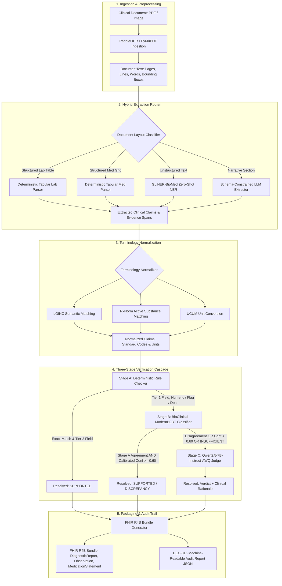

# AI-Based Multimodal Clinical Document-to-EHR Conversion and Verification (Clindoc2FHIR)

An end-to-end, audit-grounded clinical document conversion and verification pipeline that extracts structured clinical findings from heterogeneous clinical documents (laboratory reports, medication order sheets, narrative notes), normalizes them against standard medical terminologies (LOINC, RxNorm, UCUM), verifies them through a selective multi-stage cascade, and emits standards-compliant HL7 FHIR R4B resources accompanied by machine-readable DEC-016 provenance audit trails.

---

## 1. Project Overview

Clindoc2FHIR is an academic engineering and research system designed to address the high-stakes data-integrity challenge of converting unstructured and semi-structured clinical documents into electronic health records (EHR). Ungrounded large language model (LLM) pipelines routinely introduce hallucinations, numeric transposition errors, and unverified assertions into downstream medical records without source traceability. 

This repository implements a document-fidelity pipeline where every extracted clinical claim is tied to verbatim source evidence (character offsets and spatial bounding boxes) and verified through a three-stage cascade: deterministic symbolic checks, a fine-tuned biomedical transformer classifier (`BioClinical-ModernBERT-base`), and a prompted LLM judge (`Qwen2.5-7B-Instruct-AWQ`). The system operates under a selective classification formulation: resolving high-confidence claims autonomously at zero LLM inference cost while escalating ambiguous or high-risk claims to the LLM judge. Outputs are emitted as HL7 FHIR Release 4B Bundles paired with standalone audit reports adhering to strict JSON Schema contracts.

---

## 2. Problem Statement

Clinical document ingestion is a high-stakes data-integrity problem across scanned paper charts, legacy digital PDFs, and narrative consultation notes. Ungrounded extraction introduces severe operational and data-integrity risks into downstream systems:

1. **Hallucination and Transcription Drift:** Generative models often fabricate plausible-looking laboratory values, misinterpret units, or alter medication dosages during unstructured generation.
2. **Missing Evidence Assertions:** Upstream OCR noise and complex tabular layouts frequently lead to extracted claims that have no basis in the source document.
3. **Lack of Verifiable Provenance:** Commercial and open-source ingestion tools often emit FHIR resources without fine-grained spatial or textual pointers linking individual data elements back to original source pixels.
4. **Compute and Latency Costs:** Passing every clinical claim through a large language model is computationally prohibitive for high-volume hospital ingestion.

---

## 3. Key Contributions and Novelty

- **Selective Verification Cascade:** A multi-tier cascade (Stage A deterministic rules -> Stage B `BioClinical-ModernBERT-base` -> Stage C `Qwen2.5-7B-Instruct-AWQ`) that cuts benchmark errors by 43.90% compared to standalone ModernBERT and 60.34% compared to standalone Qwen-7B, while running nearly 4x faster than pure LLM inference.
- **Architectural Routing over Pure Confidence:** Demonstrates that combining symbolic prechecks (Stage A) with neural classification (Stage B) identifies overconfident ModernBERT errors that confidence thresholding alone misses, achieving a 6.1x empirical risk reduction on the autonomous operating subset.
- **DEC-016 Two-Tier Provenance:** Comprehensive auditability linking every FHIR resource and element to source document IDs, verbatim text snippets, page numbers, and exact spatial bounding boxes `[x0, y0, x1, y1]`.
- **Hybrid Extraction Architecture:** Combines deterministic row-level regex parsers for born-digital tables, zero-shot entity extraction via GLiNER-BioMed, and schema-constrained LLM parsing for unstructured clinical narratives.
- **Rigorous M2 V3 Benchmark:** A 120-document corpus comprising 5,629 certified claims across 50 lab reports, 50 medication sheets, and 20 narrative discharge notes, evaluated across strict train, calibration, validation, and template-holdout out-of-distribution (OOD) splits.

---

## 4. System Architecture



---

## 5. End-to-End Pipeline

1. **Ingestion & Text Model:** Input documents (PDF, TIFF, PNG, JPEG) are parsed into a canonical `DocumentText` schema containing page dimensions, text blocks, lines, tokens, character offsets, and physical bounding coordinates.
2. **Layout Routing:** Documents are classified into tabular lab reports, structured medication sheets, or unstructured clinical narrative notes.
3. **Extraction & Evidence Grounding:** Claims are extracted using specialized extractors. Every claim captures an `evidence_id`, character start/end offsets, and normalized bounding box coordinates.
4. **Terminology Normalization:** Laboratory analyte names map to LOINC codes, medication strings map to RxNorm concept identifiers, and units map to unified UCUM representations with automatic dimensional scaling.
5. **Multi-Stage Verification:** Extracted claims and their aligned OCR context pass through the cascade to determine whether the claim is `SUPPORTED`, a `DISCREPANCY`, or has `INSUFFICIENT_EVIDENCE`.
6. **FHIR R4B Generation:** Verified claims are converted into compliant FHIR resources with custom `claim-provenance` extensions.
7. **Audit Report Generation:** A standalone, machine-readable JSON audit report records the end-to-end provenance, stage reached, confidence score, and LLM clinical rationale for every claim.

---

## 6. Core Components

### OCR and Evidence Representation
- Built on PyMuPDF (for born-digital text extraction) and PaddleOCR (for scanned images and raster PDFs).
- Preserves token-level spatial coordinates `[x0, y0, x1, y1]` normalized to page dimensions `[0.0, 1.0]`.
- Implements SHA-256 document hashing to guarantee that evidence coordinates remain bound to immutable source files.

### Hybrid Extraction Router
- **Deterministic Parsers:** Rule-based regular expression and tabular layout analyzers for clean lab and medication grids.
- **GLiNER-BioMed:** Uses `Ihor/gliner-biomed-base-v1.0` for zero-shot biomedical named entity recognition on unstructured medication text.
- **Schema-Constrained LLM Extractor:** Employs structured JSON schema decoding to parse complex narrative discharge notes into structured clinical claims.

### Terminology Normalization
- Exact and semantic lookup tables for clinical analytes (LOINC), prescription drugs (RxNorm), and standard units (UCUM).
- Unit conversion engine handles metric conversions (e.g., `0.05 g` -> `50 mg`) prior to verification checks.

### Verification Cascade
- **Stage A (Deterministic):** Fast rule-based checking for exact string identity, normalized numeric equivalence, and flag directionality. Executes in ~0.03 seconds across 1,826 claims.
- **Stage B (`BioClinical-ModernBERT-base`):** 149M parameter transformer fine-tuned on the V3 clinical verification dataset. Uses text-only claim/evidence context with calibrated multi-class probabilities via temperature scaling ($T = 1.146522$).
- **Stage C (`Qwen2.5-7B-Instruct-AWQ`):** 4-bit quantized 7B parameter LLM served via vLLM. Governed by Prompt V1, which enforces strict reference range interpretation rules and requires structured JSON output with clinical rationales.

### FHIR R4B Mapping and DEC-016 Provenance
- Maps laboratory findings to `DiagnosticReport` and `Observation`.
- Maps medication orders to `MedicationRequest` (orders) or `MedicationStatement` (narrative history).
- Embeds two-tier provenance extensions:
  - **Resource-level:** Claim ID, verification ID, verdict, confidence, stage reached, evidence text, source page, bounding box.
  - **Element-level:** Fine-grained extensions attached directly to `Observation.valueQuantity` and `Observation.interpretation`.

---

## 7. Verification Cascade Architecture

The verification cascade implements selective prediction to maximize accuracy while minimizing expensive LLM calls:

```
[Extracted Claim + Evidence Text]
               │
               ▼
┌──────────────────────────────┐
│ Stage A: Deterministic Check │
└──────────────┬───────────────┘
               │
       ┌───────┴────────────────────────┐
       ▼                                ▼
[Tier 2 Deterministic Fields]     [Tier 1 Learned Fields]
(Unit, Ref Range, Name)           (Value, Flag, Med Fields)
       │                                │
       ▼                                ▼
Resolved at Stage A               ┌──────────────────────────────┐
(Exit Cascade)                    │ Stage B: ModernBERT-base     │
                                  └─────────────┬────────────────┘
                                                │
                               ┌────────────────┴───────────────┐
                               ▼                                ▼
                     [Agreement & Conf ≥ 0.60]      [Escalation Triggered]
                     Resolved at Stage B            - Stage A/B Disagreement
                     (Exit Cascade)                 - Stage B Calibrated Conf < 0.60
                                                    - Stage B INSUFFICIENT_EVIDENCE
                                                                │
                                                                ▼
                                                   ┌──────────────────────────────┐
                                                   │ Stage C: Qwen2.5-7B-AWQ      │
                                                   └────────────┬─────────────────┘
                                                                │
                                                                ▼
                                                    Resolved at Stage C
                                                    (Verdict + Rationale)
```

- **Escalation Triggers:** Escalation occurs if Stage A and Stage B disagree on the predicted label, if Stage B calibrated confidence falls below $\tau = 0.60$, or if Stage B predicts `INSUFFICIENT_EVIDENCE`.
- **Symbiosis:** 99.21% of escalations are triggered by symbolic-neural disagreement. Stage A serves as a high-precision symbolic routing and checking mechanism, catching overconfident ModernBERT misclassifications.

---

## 8. Dataset and Benchmark Setup

The system was evaluated on the canonical **M2 V3 Benchmark**, generated from synthetic Synthea patient profiles, rendered clinical templates, and controlled multi-level degradation:

| Split Partition | Documents | Total Claims | Clean / Degraded Claims | Finding Groups (DEC-015) | Description |
|:---|:---:|:---:|:---:|:---:|:---|
| **Train** | 52 | 2,242 | 1,544 / 698 | 832 | Model training set |
| **Calibration** | 17 | 678 | 468 / 210 | 250 | Temperature scaling & threshold calibration |
| **Validation** | 17 | 883 | 609 / 274 | 326 | In-distribution template validation |
| **OOD Holdout** | 34 | 1,826 | 1,257 / 569 | 670 | Unseen clinical templates (Out-of-Distribution) |
| **Full Benchmark** | **120** | **5,629** | **3,878 / 1,751** | **2,078** | **50 Lab, 50 Med, 20 Narrative** |

### Benchmark Composition
- **Class Distribution:** 2,270 `SUPPORTED` (40.3%), 2,925 `DISCREPANCY` (52.0%), 434 `INSUFFICIENT_EVIDENCE` (7.7%).
- **Hard Negative Perturbations:** 6 controlled transformation types: numeric value perturbation, flag flipping, unit swapping, medication name substitution, dosage alteration, and evidence removal/scrambling.
- **Zero Leakage:** Complete document-level and composite-group-level segregation between splits.

---

## 9. Main Verification Results

All models were evaluated on the frozen **V3 Out-Of-Distribution (OOD)** benchmark comprising **1,826 claims** across 34 unseen clinical document templates:

| Model / Pipeline Variant | Architecture | Accuracy | Macro-F1 | Discrepancy Recall | Errors | Runtime (1,826 claims) |
|:---|:---|:---:|:---:|:---:|:---:|:---:|
| **V1: Deterministic Matcher** | Rule-based parser | 0.7015 | 0.4609 | 0.9765 | 545 | **0.03 seconds** |
| **V2: Levenshtein Distance** | Character distance baseline | 0.4858 | 0.3134 | 0.6779 | 939 | 0.52 seconds |
| **V3: TF-IDF + Logistic Reg** | Linear baseline | 0.6347 | 0.7180 | 0.6810 | 667 | 1.09 seconds |
| **V4: SapBERT Embedding Sim** | Biomedical bi-encoder cosine | 0.4524 | 0.3105 | 0.4765 | 1,000 | 193.33 seconds |
| **V5: PubMedBERT Zero-Shot** | Zero-shot biomedical NLI | 0.7760 | 0.7303 | 0.6319 | 409 | 38.82 seconds |
| **V6: ModernBERT Standalone** | Fine-tuned BioClinical-ModernBERT | 0.9551 | 0.9519 | **0.9877** | 82 | ~45.0 seconds |
| **V8: Cascade Baseline (V0)** | Stage A -> B -> C (Prompt V0) | 0.9595 | 0.9422 | 0.9806 | 74 | ~1,500 seconds |
| **V8: Cascade (V1 Prompt)** | Stage A -> B -> C (Production) | **0.9748** | **0.9538** | 0.9826 | **46** | 1,598.59 seconds |
| **V9: Standalone Qwen-7B** | Prompted Qwen2.5-7B-AWQ | 0.9365 | 0.8543 | 0.9755 | 116 | 6,203.75 seconds |

### In-Distribution Validation Performance (V8 Cascade)
On the in-distribution validation split (883 claims across 17 documents):
- **Accuracy:** 0.9921 (99.21%, 876 / 883)
- **Macro-F1:** 0.9801
- **Discrepancy Recall:** 0.9978 (99.78%, 458 / 459 caught)

---

## 10. Standalone Extraction Performance (E1–E4)

Standalone extraction performance across document categories:

| Experiment | Extractor Module | Evaluation Corpus | Precision | Recall | F1 Score | Notes |
|:---|:---|:---|:---:|:---:|:---:|:---|
| **E1 / E4** | Deterministic Lab Parser | 50 Lab Documents (Clean) | 1.0000 | 1.0000 | 1.0000 | Clean born-digital tables |
| **E1 / E4** | Deterministic Med Parser | 50 Med Documents (Clean) | 1.0000 | 1.0000 | 1.0000 | Clean prescription grids |
| **E2** | GLiNER-BioMed (Micro) | 120 Documents (All) | 0.4390 | 0.1737 | 0.2489 | Real zero-shot NER |
| **E2** | GLiNER-BioMed (Macro) | 120 Documents (All) | 0.3432 | 0.3541 | 0.3455 | Across 10 canonical fields |
| **E2** | GLiNER `med.name` | 120 Documents (All) | 0.9257 | 0.9648 | 0.9448 | High entity accuracy |
| **E2** | GLiNER `med.dose` | 120 Documents (All) | 0.9085 | 0.9789 | 0.9424 | High entity accuracy |
| **E3** | Narrative Extractor | 20 Narrative Documents | 0.6783 | 0.1444 | 0.2382 | Offline MockLLMProvider |

> **Documented Limitation on E3:** The standalone benchmark for narrative extraction (E3) was evaluated using the repository's native `MockLLMProvider` due to cold-start execution constraints. Standalone production Qwen/vLLM evaluation was not rerun offline.

---

## 11. Selective Prediction and Risk-Coverage (V12)

Under the selective classification framework ([`PROJECT_SPEC.md`](PROJECT_SPEC.md) §21.5), the cascade routes claims between autonomous resolution (Tier 1) and LLM adjudication (Tier 2):

| Operating Dimension | Standalone ModernBERT (V6) | V8 Production Cascade (V8 V1) | Impact / Tradeoff |
|:---|:---:|:---:|:---|
| **Autonomous Coverage (Tier 1)** | 79.13% (1,445 claims) | **79.13% (1,445 claims)** | Settled at zero LLM cost |
| **Autonomous Accuracy** | 95.78% (61 errors) | **99.31% (10 errors)** | **+3.53% accuracy** |
| **Autonomous Empirical Risk** | 0.0422 | **0.0069** | **6.1x lower risk** |
| **Escalation Rate to Stage C** | 0.0% (No escalation) | **20.87% (381 claims)** | Targeted triage to LLM |
| **Stage C Escalated Accuracy** | *81.10% (Stage B counterfactual)* | **90.55% (345 / 381 correct)** | **+9.45% (+36 errors salvaged)** |
| **Full Benchmark Accuracy** | 95.51% (82 errors) | **97.48% (46 errors)** | **43.90% relative error drop** |

### Area Under the Risk-Coverage Curve (AURC)
- **Stage B Standalone (Calibrated $T=1.1465$):** `AURC = 0.034600`
- **Stage B Standalone (Raw Softmax):** `AURC = 0.034700`
- **Full Cascade (Naive Joint Confidence):** `AURC = 0.054300`
- **AURC Interpretation:** Full cascade naive joint confidence ranking displays elevated AURC because Stage C outputs an uncalibrated scalar confidence of `1.0`. This places escalated claims (error rate 9.45%) at the start of the risk curve. The operational advantage is captured by the dual-gate routing, which delivers a **6.1x risk reduction** on the autonomous operating subset compared to unassisted confidence thresholding.

---

## 12. FHIR R4B and Provenance Conformance

Downstream interoperability was evaluated across all 34 OOD documents (1,826 claims):

| Evaluation Metric | Historical Baseline (`data/fhir_phase5_v8/`) | Remediated Tier (`data/fhir_phase5_v8_remediated/`) |
|:---|:---:|:---:|
| **FHIR Schema Validity Rate** | **100.0%** (34 / 34 bundles valid, 0 errors) | **100.0%** (34 / 34 bundles valid, 0 errors) |
| **DEC-016 Provenance Completeness** | **100.0%** (1,826 / 1,826 claims populated) | **100.0%** (1,826 / 1,826 claims populated) |
| **Physical Bounding Boxes Preserved** | 1,719 bboxes (107 zero-area absence controls) | 1,719 bboxes (107 zero-area absence controls) |
| **LOINC Concept Coding Rate** | 0 / 603 (0.00%) | **603 / 603 (100.00%)** |
| **RxNorm Concept Coding Rate** | 0 / 94 (0.00%) | **94 / 94 (100.00%)** |
| **UCUM Unit System and Code** | 0 / 697 (0.00%) | **697 / 697 (100.00%)** |
| **Strict Compound §21.7 Accuracy** | 12.92% (236 / 1,826) | **59.86% (1,093 / 1,826)** |
| **Conditional In-Bundle Value Accuracy** | 96.73% (1,093 / 1,130) | **96.73% (1,093 / 1,130)** |

> **Dual-Tier History:** In the historical Phase 5 baseline, terminology fields were omitted during claim reconstruction, causing 0% LOINC/RxNorm coding. This was corrected in the remediated post-audit tier via deterministic parameter propagation without modifying verification verdicts or rerunning ML inference. Both tiers are preserved for audit transparency.

---

## 13. Limitations and Safety Boundaries

1. **Synthetic and Semi-Synthetic Benchmark:** The benchmark was synthesized from Synthea patient profiles and rendered clinical layouts with artificial degradation. It does not replicate handwritten clinical records, carbon copies, or actual hospital fax artifacts.
2. **PhysioNet / n2c2 Access Boundary:** Evaluation on the external n2c2 2018 Track 2 benchmark is `FEASIBILITY-GATED` due to institutional Data Use Agreement (DUA) and credentialing requirements.
3. **E3 Standalone Evaluation Environment:** Standalone E3 narrative extraction used `MockLLMProvider`; production Qwen-7B was evaluated in the verification cascade but not as a standalone narrative extractor.
4. **Partial E5 Degradation Matrix:** Comprehensive OCR degradation evaluation was conducted on laboratory reports (`m1_robustness_report.json`); medication and narrative degradation matrices remain unexecuted.
5. **Unexecuted Experimental Variants:**
   - **V7 (OCR-Aware ModernBERT) & V11 (Feature Ablation):** Documented as unexecuted due to compute and time constraints.
   - **V13 (LoRA Fine-Tuned Small LLM):** Designated as optional in project specification; unexecuted.
6. **Fidelity vs. Clinical Correctness Boundary:** The verification model verifies **document-evidence fidelity** (whether an extracted claim matches source document text). It does **not** evaluate clinical appropriateness, pharmacological contraindications, or medical truth.
7. **Not a Clinical Device:** This software is an academic research engineering prototype and is **not clinically validated or approved for production clinical decision support**.

---

## 14. Repository Structure

```
.
├── configs/                          # Pipeline and model configuration files
│   ├── extraction.yaml               # Extractor thresholds and provider settings
│   ├── m2_train_config.json          # ModernBERT hyperparameters and auxiliary dims
│   └── split_config.yaml             # Canonical split manifest rules
├── data/
│   ├── m2_verification_v3/           # Canonical 120-document V3 benchmark dataset
│   │   ├── all_examples.jsonl        # 5,629 certified claims
│   │   └── split_manifest.json       # Document split mapping
│   ├── fhir_phase5_v8/               # Historical Phase 5 baseline FHIR bundles
│   └── fhir_phase5_v8_remediated/    # Remediated Phase 5 FHIR bundles (100% coded)
├── experiments/                      # Experiment logs, data sheets, and reports
│   ├── FINAL_REPORT_DATA_SHEET.md    # Sole authoritative numerical source
│   ├── FINAL_PROJECT_RECONCILIATION_AUDIT.md # Final requirements audit
│   ├── E2-gliner-extraction/         # Standalone GLiNER evaluation artifacts
│   ├── E3-narrative-extraction/      # Standalone narrative evaluation artifacts
│   ├── E4-hybrid-router-extraction/  # Hybrid router evaluation artifacts
│   └── V8-verification-cascade/      # Cascade evaluation logs and V12 risk-coverage
├── reports/                          # Comprehensive audit and synthesis reports
│   ├── FINAL_PROJECT_REPORT.md       # Master 32-section final project report
│   ├── PHASE2_RECONCILIATION_REPORT.md
│   └── PHASE6_RECONCILIATION_REPORT.md
├── schemas/                          # Canonical JSON Schema contracts
│   ├── claim.json                    # Canonical 10-field claim schema
│   ├── evidence.json                 # Character offset & bounding box contract
│   ├── verification_result.json      # Verification result schema
│   └── audit_report.json             # DEC-016 standalone audit report schema
├── scripts/                          # Utility scripts for training and auditing
│   ├── audit_benchmark.py            # Dataset split and integrity checker
│   ├── generate_v3_benchmark.py      # V3 benchmark generator
│   └── train_v3_experiment.py        # ModernBERT training entry point
├── src/clindoc/                      # Core application package
│   ├── audit/                        # DEC-016 audit report generation
│   ├── cli.py                        # Unified command-line interface
│   ├── extract/                      # Extraction router, parsers, and contracts
│   ├── fhir/                         # FHIR R4B mapping and provenance extensions
│   ├── m2/                           # ModernBERT dataset, model, and metrics
│   ├── normalize/                    # LOINC, RxNorm, and UCUM normalizers
│   ├── ocr/                          # DocumentText schema, ingestion, and OCR
│   ├── web/                          # FastAPI app + static website (clindoc serve)
│   └── verify/                       # Verification cascade orchestrator
├── tests/                            # Automated unit, integration, evaluation, and schema tests
├── pyproject.toml                    # Package metadata and dependencies
└── uv.lock                           # Locked dependency tree
```

---

## 15. How to Run the Project

### Prerequisites
- **Operating System:** Windows 10/11 or Linux (Ubuntu 22.04+)
- **Python Version:** Python 3.11 (`3.11.x` required)
- **Local GPU:** NVIDIA GPU with 6 GB+ VRAM (tested on RTX 3050) for local ModernBERT inference.
- **Remote LLM Host (Optional):** External vLLM instance serving `Qwen/Qwen2.5-7B-Instruct-AWQ` on a 16 GB GPU (tested on Tesla T4) for Stage C LLM adjudication. If unavailable, the pipeline falls back to `MockLLMProvider`.

### Environment Setup
```bash
# Clone the repository
git clone https://github.com/nobody294469/DAA.git
cd DAA

# Create and activate a Python 3.11 virtual environment
python -m venv .venv
source .venv/bin/activate       # On Linux/macOS
.venv\Scripts\activate          # On Windows

# Install package and dependencies
pip install -e .[ml,web,ocr,dev]
```

### 1. Process a Single Clinical Document
Run the end-to-end pipeline on an individual document (PDF, image, or DocumentText JSON):
```bash
clindoc process data/rendered/LAB_0001.pdf --output-dir output/LAB_0001
```
Outputs:
- `output/LAB_0001/fhir_bundle.json`: Standards-compliant FHIR R4B Bundle.
- `output/LAB_0001/audit_report.json`: DEC-016 provenance audit trail.

### 2. Batch Process a Document Directory
```bash
clindoc batch data/rendered/ --output-dir output/batch_run/ --pattern "*.pdf"
```

### 3. Launch the Web App
Run the website and JSON API (workbench, playground, explorer, results, model card) at http://127.0.0.1:8000:
```bash
clindoc serve --checkpoint data/m2_results_v3/checkpoints/<run>.pt
```
Optional Google sign-in (`CLINDOC_GOOGLE_CLIENT_ID`, `CLINDOC_SESSION_SECRET`) and the Cloud Run
container (`Dockerfile`) are covered in [docs/deploy.md](docs/deploy.md). Open-data training sets for
Stage B are built with `scripts/build_open_claims.py` and trained on Colab with `scripts/colab_train_stage_b.ipynb`.

### 4. Run the Automated Test Suite
Execute the full unit, integration, and schema validation test suite:
```bash
pytest
```
To run targeted subsystem tests:
```bash
# Verification cascade tests
pytest tests/test_verification_cascade.py

# FHIR mapping and DEC-016 provenance tests
pytest tests/test_canonical_fhir_mapping.py

# Benchmark split integrity tests
pytest tests/test_m2_splits.py tests/test_m2_3way_splits.py
```

---

## 16. Reproducibility Notes

- **Deterministic Seeds:** All dataset splitting and baseline evaluations use fixed random seeds (`seed=42`).
- **Benchmark Integrity:** The canonical V3 benchmark files are anchored by SHA-256 hashes (`all_examples.jsonl`: `40278c01...`, `split_manifest.json`: `cf41cc1d...`).
- **Hardware Profile:**
  - ModernBERT Stage B training and inference: Local NVIDIA GeForce RTX 3050 (6 GB).
  - Qwen2.5-7B AWQ Stage C serving: Remote NVIDIA Tesla T4 (16 GB) via vLLM with OpenAI-compatible API.
  - Deterministic evaluation & FHIR serialization: Local CPU (~18 seconds for 34 bundles / 1,826 claims).

---

## 17. Project Information

- **Project:** AI-Based Multimodal Clinical Document-to-EHR Conversion and Verification (Clindoc2FHIR)
- **Document Identifier:** `CLINDOC-FINAL-REPORT-2026`
- **Development Team:** Clindoc2FHIR Team
- **Authoritative Specification:** [`PROJECT_SPEC.md`](PROJECT_SPEC.md)
- **Authoritative Numerical Data Sheet:** [`experiments/FINAL_REPORT_DATA_SHEET.md`](experiments/FINAL_REPORT_DATA_SHEET.md)
- **Reconciliation Audit:** [`experiments/FINAL_PROJECT_RECONCILIATION_AUDIT.md`](experiments/FINAL_PROJECT_RECONCILIATION_AUDIT.md)
- **Final Master Report:** [`reports/FINAL_PROJECT_REPORT.md`](reports/FINAL_PROJECT_REPORT.md)

---

## 18. License

This project declares the **MIT License** in `pyproject.toml` (`license = { text = "MIT" }`). A standalone `LICENSE` text file has not yet been added to the repository root.
