# CLINICALDOC: SYSTEM ARCHITECTURE & END-TO-END WORKFLOWS

**Document Authority**: Authoritative Architecture Specification (Tier 1)  
**Repository**: `nobody294469/DAA` (`d:\daa`)  
**Audit Status**: Verified against Current Codebase (Post-Step 6)  
**Date**: November 2026

---

## 1. High-Level Architecture Overview

ClinicalDoc is designed on a principle of **hierarchical defensive validation**: raw clinical input is parsed into candidate hypotheses (atomic claims), grounded in source document geometry, evaluated by an automated multi-stage verification cascade, triaged for human-in-the-loop review, and cryptographically attested before transmission to hospital Electronic Health Record (EHR) systems.

### 1.1 End-to-End Architecture Diagram

```mermaid
flowchart TD
    subgraph INGESTION ["1. Ingestion & Preprocessing"]
        DocInput["Document Input\n(PDF, TIFF, PNG, Text)"] --> IngestService["src/clindoc/ingest/ingest.py\nFile Validation & MIME Detection"]
        IngestService --> OCRPipeline["src/clindoc/ocr/pipeline.py\nLayout Analysis & OCR Engine\n(Tesseract / Surya / PaddleOCR)"]
        OCRPipeline --> DocText["src/clindoc/ocr/document_text.py\nCharacter Geometry & Bounding Boxes"]
    end

    subgraph EXTRACTION ["2. Entity Extraction & Claim Generation"]
        DocText --> ExtractorRouter["src/clindoc/extract/router.py\nExtraction Strategy Dispatcher"]
        ExtractorRouter --> RuleExtract["src/clindoc/extract/deterministic.py\nRegex & Table Rule Extractor\n(Labs, Vitals, Structured Meds)"]
        ExtractorRouter --> GLiNERExtract["src/clindoc/extract/gliner_bridge.py\nZero-Shot Clinical NER\n(Conditions, Anatomy, Prose Meds)"]
        ExtractorRouter -.-> LLMExtract["src/clindoc/extract/llm_extractor.py\n(External vLLM GPU Server - Optional)"]
        RuleExtract --> Claims["src/clindoc/schema/claim.py\nAtomic Claims (Type, Value, Code, Span)"]
        GLiNERExtract --> Claims
        LLMExtract -.-> Claims
    end

    subgraph VERIFICATION ["3. Three-Stage Verification Cascade"]
        Claims --> Cascade["src/clindoc/verify/cascade.py\nVerification Engine"]
        Cascade --> StageA["src/clindoc/verify/stage_a.py\nStage A: Exact String & Coord Alignment\n(Levenshtein <= 0.15, Strict Coordinates)"]
        StageA --> StageB["src/clindoc/verify/stage_b.py\nStage B: NLI Entailment\n(DeBERTa-v3 cross-encoder, threshold >= 0.85)"]
        StageB --> StageC["src/clindoc/verify/stage_c.py\nStage C: Clinical Domain Sanity\n(Unit ranges, route-frequency syntax, dosage)"]
        StageC --> VerResults["src/clindoc/schema/verification_result.py\nVerification Status (VERIFIED, CONTRADICTED, UNVERIFIED)"]
    end

    subgraph RECONCILIATION ["4. Patient Identity & Temporal Association"]
        VerResults --> MPIVerify["src/clindoc/extract/patient_matcher.py\nMaster Patient Index (MPI) Verification\n(MRN, DOB, Name Matching)"]
        MPIVerify --> MedLifecycle["src/clindoc/extract/medication_association.py\nREQ-44 9-Category Evidence Matrix\n(Active vs Stopped vs Suppressed)"]
    end

    subgraph REVIEW ["5. Human Review & Dual-Custody Governance"]
        MedLifecycle --> Triage["src/clindoc/review/triage.py\nMode 0 Triage (Auto-route unverified claims)"]
        Triage --> ReviewUI["src/clindoc/review/service.py\nClinician Review Interface\n(Accept, Edit, Reject, Span View)"]
        ReviewUI --> FourEyes["src/clindoc/review/approval.py\nF-12 Four-Eyes Verification\n(Root Ancestry Locking v1 != Approver)"]
    end

    subgraph AUDIT ["6. Crash-Consistent Audit Architecture (DEF-003)"]
        FourEyes --> PostgresOutbox["src/clindoc/db/models.py\nPostgreSQL clindoc_audit_events\n(Atomic Transactional Outbox Commit)"]
        PostgresOutbox --> ProjectionEngine["src/clindoc/audit/projection.py\nAuditProjectionEngine.reconcile_outbox()\n(Full-Prefix Continuous Verification)"]
        ProjectionEngine --> JSONLLedger["data/audit/audit_ledger.jsonl\nHash-Chained File (SHA-256)"]
        ProjectionEngine --> HMACCheckpoint["data/audit/audit_checkpoint.json\nHMAC-SHA256 Root Checkpoint"]
        ProjectionEngine -.-> Quarantine["src/clindoc/audit/quarantine.py\nForensic Streaming Quarantine\n(Safe Recovery on Ledger Corruption)"]
    end

    subgraph GATE9 ["7. Gate 9 Attestation & Signing"]
        JSONLLedger --> AttestationGateway["src/clindoc/services/fhir_export.py\nAttestationGateway.verify_and_sign()"]
        HMACCheckpoint --> AttestationGateway
        PostgresOutbox --> AttestationGateway
        AttestationGateway --> CanonicalDigest["src/clindoc/fhir/signing.py\nCanonical Bundle Digest (SHA-256)\n(Transient fields excluded)"]
        CanonicalDigest --> Signer["Ed25519 Cryptographic Signer\nBundle.signature Generation"]
        Signer --> SignedFHIR["Signed FHIR R4B Bundle\n(type='document', valid schema)"]
    end

    subgraph CONTAINMENT ["8. CLI Draft Containment (DEF-004)"]
        Claims -.-> CLIProcess["src/clindoc/cli.py (process / batch)\nDirect Execution without Gate 9"]
        CLIProcess --> DraftTags["Normative Draft Meta Tags:\nUNREVIEWED_CLI_DRAFT\nUNAUTHORIZED_RESEARCH_DRAFT\nOmitted Signature"]
        DraftTags --> DraftFile["fhir_bundle.draft.json\n+ GOVERNANCE_NOTICE.txt"]
    end

    subgraph DISPATCH ["9. Institutional Transport Boundaries"]
        SignedFHIR --> TransportAssert["src/clindoc/services/ehr_transport.py\nassert_no_draft_tags() Verification"]
        DraftFile -.-> TransportAssert
        TransportAssert -->|Draft Tag Detected| Reject["EHRDraftRejectionError\nHTTP 403 Forbidden\n(Payload Dropped)"]
        TransportAssert -->|Signed & Authorized| Transports["Institutional EHR Transports"]
        Transports --> HTTPTransport["HTTP REST Transport\n(FHIR R4B Endpoint, mTLS + OAuth2)"]
        Transports --> MLLPTransport["MLLP Transport\n(HL7 Minimal Lower Layer Protocol)"]
        Transports --> MockTransport["Mock Transport\n(Testing & Dry-Run Integration)"]
    end

    style Reject fill:#ff9999,stroke:#cc0000,stroke-width:2px;
    style SignedFHIR fill:#99ff99,stroke:#009900,stroke-width:2px;
    style DraftFile fill:#ffff99,stroke:#cccc00,stroke-width:2px;
```



---

## 2. Component Implementation Details

### 2.1 Ingestion and Preprocessing
- **Source Module**: [`src/clindoc/ingest/`](file:///d:/daa/src/clindoc/ingest/)
- **Implementation State**: **IMPLEMENTED**
- **Responsibilities**:
  - Validates document MIME type and magic byte signatures (PDF, TIFF, PNG, JPEG, plain UTF-8 text).
  - Enforces size ceilings (default 50 MB) and page limits (default 100 pages per document).
  - Generates a UUIDv4 `document_id` and registers initial metadata in PostgreSQL `clindoc_documents`.
  - Normalizes PDF orientation, performs deskewing transformations, and rasterizes pages to high-resolution images (300 DPI) for OCR inspection.

### 2.2 OCR and Text Extraction
- **Source Module**: [`src/clindoc/ocr/`](file:///d:/daa/src/clindoc/ocr/)
- **Implementation State**: **IMPLEMENTED**
- **Responsibilities**:
  - Direct born-digital text extraction using PyMuPDF (`fitz`), capturing character positions, font metrics, and exact coordinate bounding boxes `(x0, y0, x1, y1)`.
  - Fallback OCR pipeline using `Tesseract` (via `pytesseract`) or `Surya` layout detector for scanned raster images.
  - Generates [`src/clindoc/ocr/document_text.py`](file:///d:/daa/src/clindoc/ocr/document_text.py) objects that provide a canonical character offset mapping, enabling exact substring grounding.
  - Implements table border and cell layout detection (`table_layout.py`) to preserve row/column relationships in structured laboratory reports.

### 2.3 Clinical Entity Extraction
- **Source Module**: [`src/clindoc/extract/`](file:///d:/daa/src/clindoc/extract/)
- **Implementation State**: **IMPLEMENTED (Hybrid: Local Rules + GLiNER; External vLLM Dependent)**
- **Responsibilities**:
  - **Deterministic Extractors** ([`deterministic.py`](file:///d:/daa/src/clindoc/extract/deterministic.py), [`lab_parser.py`](file:///d:/daa/src/clindoc/extract/lab_parser.py), [`med_parser.py`](file:///d:/daa/src/clindoc/extract/med_parser.py)): Extract highly structured clinical data (laboratory analyte names, numeric values, units, reference ranges, medication names, dosages, routes, frequencies).
  - **GLiNER Clinical NER** ([`gliner_bridge.py`](file:///d:/daa/src/clindoc/extract/gliner_bridge.py)): Executes zero-shot named entity recognition using lightweight Transformer embeddings for unstructured clinical prose (conditions, anatomical locations, clinical observations).
  - **LLM Extractor** ([`llm_extractor.py`](file:///d:/daa/src/clindoc/extract/llm_extractor.py)): Connects via OpenAI-compatible REST API to an external vLLM GPU instance for complex narrative synthesis. In the local standalone environment, the pipeline defaults gracefully to deterministic rules and GLiNER.

### 2.4 Three-Stage Verification Cascade
- **Source Module**: [`src/clindoc/verify/`](file:///d:/daa/src/clindoc/verify/)
- **Implementation State**: **IMPLEMENTED**
- **Architecture**:
  ```
  Candidate Claim ────► [ Stage A: String Alignment ] ────► PASS ────► [ Stage B: NLI Entailment ] ────► PASS ────► [ Stage C: Clinical Sanity ] ────► VERIFIED
                                │                                              │                                           │
                              FAIL                                           FAIL                                        FAIL
                                │                                              │                                           │
                                ▼                                              ▼                                           ▼
                            UNVERIFIED / CONTRADICTED ◄────────────────────────┴───────────────────────────────────────────┘
                                │
                                ▼
                       Mode 0 Clinician Triage
  ```
  1. **Stage A (Textual Alignment)** ([`stage_a.py`](file:///d:/daa/src/clindoc/verify/stage_a.py)): Verifies that candidate claims exist verbatim or within a tight normalized Levenshtein edit distance ($\le 0.15$) in the OCR text, and validates character coordinate bounding boxes.
  2. **Stage B (NLI Entailment)** ([`stage_b.py`](file:///d:/daa/src/clindoc/verify/stage_b.py)): Evaluates premise-hypothesis entailment using `DeBERTa-v3`. If the premise contradicts the claim or entailment confidence falls below $0.85$, the claim is marked `UNVERIFIED` or `CONTRADICTED`.
  3. **Stage C (Clinical Sanity)** ([`stage_c.py`](file:///d:/daa/src/clindoc/verify/stage_c.py)): Applies deterministic medical logic (e.g., verifying serum potassium is biologically plausible between 1.5 and 9.0 mmol/L, verifying medication routes match standard pharmaceutical pharmacopeia).

### 2.5 Evidence Grounding and Provenance
- **Source Module**: [`src/clindoc/schema/claim.py`](file:///d:/daa/src/clindoc/schema/claim.py), [`src/clindoc/fhir/mapper.py`](file:///d:/daa/src/clindoc/fhir/mapper.py)
- **Implementation State**: **IMPLEMENTED**
- **Responsibilities**:
  - Every claim retains a mandatory `evidence_spans` list containing:
    - `page_number`: 1-indexed document page.
    - `start_char` / `end_char`: Absolute character offsets in `document_text`.
    - `bbox`: Normalized coordinates `[x0, y0, x1, y1]`.
    - `text`: Verbatim text snippet extracted from the source document.
  - When mapped to FHIR R4B, every resource includes an extension pointing to a `Provenance` resource that binds the target resource to the original source document SHA-256 hash and bounding coordinates.

### 2.6 Human Review Interface & Mode 0
- **Source Module**: [`src/clindoc/review/service.py`](file:///d:/daa/src/clindoc/review/service.py), [`src/clindoc/review/triage.py`](file:///d:/daa/src/clindoc/review/triage.py)
- **Implementation State**: **IMPLEMENTED**
- **Responsibilities**:
  - **Mode 0 Triage**: Automatically partitions claims into Auto-Acceptable (verified across all 3 cascade stages with confidence $\ge 0.95$) versus Review-Mandatory (contradicted, low-confidence, or high-risk clinical entities like anticoagulants, insulin, and critical lab values).
  - Provides REST endpoints for CDI specialists and clinicians to inspect evidence spans, view document snippets, accept claims, modify incorrect values, or reject false positive extractions.
  - Maintains an immutable revision history in PostgreSQL `clindoc_review_revisions`.

### 2.7 Patient Identity Verification
- **Source Module**: [`src/clindoc/extract/deterministic.py`](file:///d:/daa/src/clindoc/extract/deterministic.py), [`src/clindoc/fhir/mapper.py`](file:///d:/daa/src/clindoc/fhir/mapper.py)
- **Implementation State**: **IMPLEMENTED**
- **Responsibilities**:
  - Extracts patient identifiers: Medical Record Number (MRN), Social Security Number (SSN/National ID), Full Legal Name, and Date of Birth (DOB).
  - Cross-references identifiers across multiple pages to ensure document consistency.
  - If conflicting patient names or MRNs are found within the same document packet, the pipeline immediately halts with an `IdentityMismatchError`, failing closed to prevent misattribution.

### 2.8 Four-Eyes Multi-Hop Approval (F-12)
- **Source Module**: [`src/clindoc/review/approval.py`](file:///d:/daa/src/clindoc/review/approval.py)
- **Implementation State**: **IMPLEMENTED**
- **Responsibilities**:
  - Implements multi-hop revision traversal across the full version ancestry tree ($v_1 \to v_2 \to \dots \to v_k$).
  - Prevents dual-custody evasion:
    $$\text{Approver}(v_k) \neq \text{Creator}(v_1) \quad \land \quad \text{Approver}(v_k) \notin \{\text{Editors}(v_1, \dots, v_{k-1})\}$$
  - Any attempt by the original uploader or an intervening editor to approve the document raises `FourEyesViolationError`.

### 2.9 Medication Lifecycle and REQ-44
- **Source Module**: [`src/clindoc/extract/medication_association.py`](file:///d:/daa/src/clindoc/extract/medication_association.py), [`src/clindoc/services/fhir_export.py`](file:///d:/daa/src/clindoc/services/fhir_export.py)
- **Implementation State**: **IMPLEMENTED**
- **Responsibilities**:
  - Enforces semantic safety around prescription states using the 9-category evidence matrix:
    - Explicit active orders $\to$ `MedicationStatement.status = "active"`.
    - Explicit historical or stopped orders $\to$ `MedicationStatement.status = "stopped"`.
    - Patient-reported omissions $\to$ `MedicationStatement.status = "not-taken"`.
    - Unreferenced cancellation directives lacking an order ID (Category 9) $\to$ `UNREFERENCED_ORDER_CANCELLATION_FAIL_CLOSED` (resource emission completely suppressed).

### 2.10 FHIR R4B Mapping and Validation
- **Source Module**: [`src/clindoc/fhir/mapper.py`](file:///d:/daa/src/clindoc/fhir/mapper.py), [`src/clindoc/fhir/validator.py`](file:///d:/daa/src/clindoc/fhir/validator.py)
- **Implementation State**: **IMPLEMENTED**
- **Responsibilities**:
  - Maps internal verified claims to HL7 FHIR R4B standard resources:
    - Root: `Bundle` (`type = "document"`).
    - Header: `Composition` (`status = "final"`, standard section codes).
    - Subject: `Patient` (standard identifiers, name, birthDate, gender).
    - Observations: `Observation` (`category = "laboratory"` or `"vital-signs"`, LOINC codes, UCUM units).
    - Medications: `MedicationStatement` (RxNorm codes, dosage instructions, status).
    - Conditions: `Condition` (SNOMED CT / ICD-10-CM codes, clinicalStatus, verificationStatus).
    - Context: `Encounter`, `Practitioner`.
    - Provenance: `Provenance` linking resources to document SHA-256 and agent signatures.
  - Validates full bundle structure using `FHIRValidator.validate_bundle()` against official FHIR R4B JSON Schemas.

### 2.11 Crash-Consistent Audit Architecture (DEF-003)
- **Source Module**: [`src/clindoc/audit/`](file:///d:/daa/src/clindoc/audit/)
- **Implementation State**: **IMPLEMENTED**
- **Responsibilities**:
  - **Transactional Outbox**: Business mutations and audit events commit together in the same PostgreSQL transaction (`clindoc_audit_events`).
  - **Full-Prefix Projection Engine** ([`projection.py`](file:///d:/daa/src/clindoc/audit/projection.py)): Before projecting new events to `audit_ledger.jsonl`, reads all existing records from sequence 1 through $S_{file}$, verifying sequence continuity, previous-event SHA-256 hashes, current-event hashes, and exact match with PostgreSQL.
  - **HMAC Checkpoint Generation**: Periodically writes `audit_checkpoint.json` containing the tail sequence, tail hash, and HMAC-SHA256 signature calculated using a dedicated key (`CLINDOC_CHECKPOINT_KEY`).
  - **Forensic Streaming Quarantine** ([`quarantine.py`](file:///d:/daa/src/clindoc/audit/quarantine.py)): If ledger corruption or tampering is detected, locks the file, streams corrupted records into an isolated forensic quarantine file with metadata, truncates the ledger back to the last known valid prefix, and alerts operators.
  - **Cross-Platform Multi-Process Locking** ([`locking.py`](file:///d:/daa/src/clindoc/audit/locking.py)): Implements non-blocking and blocking file locking compatible with Windows `msvcrt` and POSIX `fcntl`.

### 2.12 Gate 9 Complete Attestation Gateway & Bundle Signing
- **Source Module**: [`src/clindoc/services/fhir_export.py`](file:///d:/daa/src/clindoc/services/fhir_export.py), [`src/clindoc/fhir/signing.py`](file:///d:/daa/src/clindoc/fhir/signing.py)
- **Implementation State**: **IMPLEMENTED**
- **Responsibilities**:
  - Gate 9 acts as the ultimate security choke-point before clinical export.
  - Checks:
    1. Document status must be `APPROVED` (under F-12 Four-Eyes dual custody).
    2. Complete PostgreSQL audit trail must match the JSONL ledger prefix.
    3. JSONL ledger HMAC checkpoint must be valid and intact.
    4. FHIR Bundle passes complete R4B schema validation.
  - **Bundle Signing**:
    - Computes a canonical SHA-256 clinical digest over the bundle payload (excluding transient fields: `id`, `meta.lastUpdated`, `meta.versionId`, `signature`).
    - Signs the digest using the institution's private Ed25519 signing key.
    - Appends a normative `Bundle.signature` element containing the signer's X.509 certificate reference, timestamp, and base64-encoded signature.
    - Emits immutable wire bytes: the exact bytes signed are guaranteed to be the bytes dispatched.

### 2.13 CLI Draft Containment (DEF-004)
- **Source Module**: [`src/clindoc/cli.py`](file:///d:/daa/src/clindoc/cli.py)
- **Implementation State**: **IMPLEMENTED**
- **Responsibilities**:
  - Any bundle generated via the command-line interface (`clindoc process` or `clindoc batch`) bypasses the human review web service and is strictly treated as an unreviewed research draft.
  - Appends normative draft tags:
    - `system="http://clindoc.org/fhir/tag/governance-status"`, `code="UNREVIEWED_CLI_DRAFT"`
    - `system="http://clindoc.org/fhir/tag/security-notice"`, `code="UNAUTHORIZED_RESEARCH_DRAFT"`
    - `Bundle.identifier` with `value="UNAUTHORIZED_RESEARCH_DRAFT"`
  - Completely omits `Bundle.signature` (no null field).
  - Atomically writes to `fhir_bundle.draft.json` and creates a companion `GOVERNANCE_NOTICE.txt`.
  - Strictly rejects `--force`, `--approved`, and `--skip-review` flags.

### 2.14 Institutional Transport Boundaries
- **Source Module**: [`src/clindoc/services/ehr_transport.py`](file:///d:/daa/src/clindoc/services/ehr_transport.py)
- **Implementation State**: **IMPLEMENTED**
- **Responsibilities**:
  - Guards Mock, HTTP REST, and MLLP transport boundaries with `assert_no_draft_tags()`.
  - If a bundle containing `UNREVIEWED_CLI_DRAFT` or `UNAUTHORIZED_RESEARCH_DRAFT` arrives at any transport call site, transmission is immediately aborted with `EHRDraftRejectionError` (mapped to HTTP 403 Forbidden in REST endpoints).
  - Enforces mandatory TLS certificate verification (`ssl_verify=False` is strictly forbidden in production configurations).

---

## 3. End-to-End Workflows

### 3.1 Workflow A: CLI Research / Draft Workflow
This workflow is used by researchers and developers evaluating extraction and verification algorithms locally.

```
[Local File (PDF/Text)]
         │
         ▼
[clindoc process / batch]
         │
         ├──► Document Ingestion & OCR
         ├──► Entity Extraction (Rules + GLiNER)
         ├──► 3-Stage Verification Cascade
         ├──► FHIR R4B Mapping
         │
         ▼
[Draft Containment Engine]
         ├──► Add Meta Tags: UNREVIEWED_CLI_DRAFT, UNAUTHORIZED_RESEARCH_DRAFT
         ├──► Add Identifier: UNAUTHORIZED_RESEARCH_DRAFT
         ├──► Strip / Omit Bundle.signature
         │
         ▼
[Atomic Output Generation]
         ├──► fhir_bundle.draft.json
         └──► GOVERNANCE_NOTICE.txt
```

### 3.2 Workflow B: Human-Reviewed Clinical Export Workflow
This workflow is the primary clinical path for hospital medical records.

```
[Document Ingested via API] ──► [Stored in DB: Status = INGESTED]
                                          │
                                          ▼
                             [Pipeline Worker Processing]
                             • OCR & Character Coordinate Grounding
                             • Extraction & Claim Decomposition
                             • 3-Stage Cascade Verification
                                          │
                                          ▼
                             [Mode 0 Triage & Review Queue]
                             • Status = PENDING_REVIEW
                             • Auto-routed to CDI / Clinician Inbox
                                          │
                                          ▼
                             [Clinician Review Interface]
                             • Clinician A reviews claims & evidence spans
                             • Accepts valid claims, edits values, rejects errors
                             • Submits Revision (Version 1, v1)
                                          │
                                          ▼
                             [Four-Eyes Dual Custody Review]
                             • Status = PENDING_APPROVAL
                             • Clinician B inspects modified v1 draft
                             • Verifies root ancestor lock (Clinician B != Clinician A)
                             • Approves Revision (Version 2, v2)
                             • Status = APPROVED
```

### 3.3 Workflow C: Gate 9 Authorization & Signing Workflow
This workflow executes immediately upon final Four-Eyes approval of a clinical document.

```
[Document Status = APPROVED]
              │
              ▼
   [Gate 9 Attestation Choke-point]
              ├── 1. Verify F-12 dual-custody approval record in PostgreSQL.
              ├── 2. Reconcile Outbox: verify DB-to-JSONL audit sequence continuity.
              ├── 3. Verify HMAC Checkpoint integrity on JSONL ledger.
              ├── 4. Validate complete bundle against FHIR R4B JSON Schema.
              ├── 5. Compute canonical SHA-256 clinical bundle digest.
              └── 6. Sign digest with institutional Ed25519 private key.
              │
              ▼
   [Bundle.signature Affixed]
              │
              ▼
   [Immutable Transport Bytes Serialized]
```

### 3.4 Workflow D: Institutional EHR Transmission Workflow
This workflow dispatches the cryptographically signed bundle across hospital network boundaries.

```
[Signed Serialized Bundle Bytes]
              │
              ▼
   [assert_no_draft_tags() Guard]
              ├── Check Bundle.meta.tag for draft codes
              └── Check Bundle.identifier for draft values
              │
              ├──────────────────────────────┐
              │ Draft Detected               │ Clean (No Draft Markers)
              ▼                              ▼
   [EHRDraftRejectionError]       [Selected Transport Boundary]
   • Log security alert                       │
   • Return HTTP 403 Forbidden                ├─► [HTTP REST Endpoint (mTLS + OAuth2)]
   • Payload dropped                          ├─► [MLLP HL7 Lower Layer Transport]
                                              └─► [Mock Transport (Dry Run)]
                                                         │
                                                         ▼
                                              [Institutional EHR Ingestion]
                                              • EHR verifies Bundle.signature
                                              • EHR commits patient resources
                                              • Transport returns HTTP 201 Created / ACK
```

---

## 4. Claim Resolution State Machine

During the extraction and review lifecycle, every atomic claim exists in a well-defined state governed by deterministic transition rules:

| Claim State | Entry Condition | Processing & Safety Action | Final Output Representation |
|---|---|---|---|
| **VERIFIED** | Successfully passed Stage A (string alignment), Stage B (NLI entailment $\ge 0.85$), and Stage C (clinical sanity). | Eligible for automatic inclusion in draft bundle; routed to Mode 0 for optional spot-check. | Emitted as standard FHIR resource (`status="final"` or `"active"`). |
| **UNVERIFIED** | Failed Stage A (text missing from OCR) or Stage B (NLI score $< 0.85$). | Quarantined in Mode 0 review queue; cannot be exported without explicit clinician confirmation. | Suppressed from export unless explicitly validated and accepted by a clinician. |
| **CONTRADICTED** | Explicitly contradicted by document text during Stage B NLI (e.g., text states "No diabetes", claim asserts "Diabetes"). | Flagged with high-priority safety alert in Mode 0 review interface. | Suppressed; clinician must either reject or overwrite with corrected evidence span. |
| **UNREFERENCED CANCELLATION** | Medication directive states "Discontinue [Drug]" without an explicit prior order ID or cessation proof (REQ-44 Cat 9). | Fail-closed suppression: `UNREFERENCED_ORDER_CANCELLATION_FAIL_CLOSED`. | **Completely suppressed**: zero `MedicationStatement` resources emitted to prevent active misrepresentation. |
| **MODIFIED BY REVIEWER** | Clinician alters extracted dosage, value, or code in Mode 0 interface. | Creates a new revision record in PostgreSQL; marks claim `status="clinician_edited"`, recording old value, new value, reviewer ID, and timestamp. | Emitted as FHIR resource with provenance extension documenting manual clinician override. |
| **REJECTED BY REVIEWER** | Clinician rejects an incorrect extraction or hallucination. | Marked `status="rejected"` in review revision; excluded from FHIR bundle. | Excluded from final bundle; retained in PostgreSQL audit table for extraction accuracy tracking. |

---

## 5. Architectural Distinctions: Implemented vs. Externally Dependent

To maintain total transparency, the following table explicitly distinguishes verified in-repo components from external infrastructure dependencies:

| Architectural Component | Implementation Status | Repository Location | External Dependency / Prerequisite |
|---|---|---|---|
| Ingestion & PDF Handling | **Fully Implemented** | `src/clindoc/ingest/` | Native PyMuPDF and pdfplumber libraries. |
| OCR Engines | **Implemented with Fallbacks** | `src/clindoc/ocr/` | Native Tesseract binaries (`tesseract-ocr`) on host OS. |
| Deterministic Extraction | **Fully Implemented** | `src/clindoc/extract/deterministic.py` | None (pure Python / regex). |
| Zero-Shot Clinical NER | **Implemented** | `src/clindoc/extract/gliner_bridge.py` | HuggingFace GLiNER weights (local CPU/GPU). |
| Narrative LLM Extraction | **Scaffolded / Remote Client** | `src/clindoc/extract/llm_extractor.py` | **External vLLM Server** with NVIDIA GPU (optional; falls back to rules). |
| 3-Stage Verification Cascade | **Fully Implemented** | `src/clindoc/verify/` | DeBERTa-v3 model weights (downloaded locally). |
| Four-Eyes Multi-Hop (F-12) | **Fully Implemented** | `src/clindoc/review/approval.py` | PostgreSQL database instance. |
| REQ-44 Medication Lifecycle | **Fully Implemented** | `src/clindoc/extract/medication_association.py` | None (deterministic clinical rules). |
| Audit Ledger & HMAC (DEF-003) | **Fully Implemented** | `src/clindoc/audit/` | Local filesystem with atomic locking (`portalocker`). |
| Gate 9 Signing Gateway | **Fully Implemented** | `src/clindoc/services/fhir_export.py` | Ed25519 private key configuration. |
| CLI Draft Containment (DEF-004) | **Fully Implemented** | `src/clindoc/cli.py` | None. |
| Transport Assertions | **Fully Implemented** | `src/clindoc/services/ehr_transport.py` | None. |
| Hospital EHR Integration | **Client Implemented** | `src/clindoc/services/ehr_transport.py` | **External Hospital EHR Server** (Epic/Cerner FHIR endpoint + mTLS certs). |
