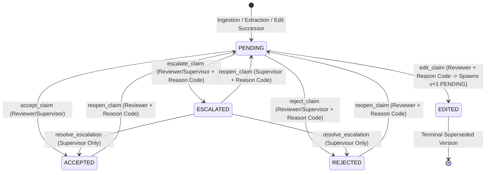

# ClinicalDoc — Phase 5.2.3 Sub-Milestone 4.2 Implementation Report
## Mode 0 ReviewService & Durable Audit Contract Implementation

**Execution Date:** 2026-10-31  
**Authority:**  
- `phase523_milestone420_review_contract.md`  
- `phase523_milestone4201_audit_integrity_addendum.md`  
- `PRODUCTIZATION_SPEC.md §4.3, §7.3`, `PD-002`, `PD-004`, `PD-009`, `PD-010`, `PD-012`, `PD-015`  
**Status:** Completed & Validated

---

### 1. Executive Summary

Sub-Milestone 4.2 implements the canonical Mode 0 `ClaimReviewService` and durable audit verification contract. It establishes rigorous human review guarantees prior to clinical export, preventing unreviewed, stale, tampered, or improperly authorized claims from bypassing safety checks into downstream healthcare systems.

Key achievements:
1. **Canonical State Machine**: Enforces strictly verified 5-state lifecycle (`PENDING`, `ACCEPTED`, `REJECTED`, `EDITED`, `ESCALATED`). Only `ACCEPTED` can satisfy clinical export requirements.
2. **Four-Eyes Separation of Duties**: Prohibits clinicians from accepting claims they created, edited, or for which they operated the source ingestion pipeline when dealing with high-risk findings (high-potency drugs, multi-entity ambiguity, coordinate bijections, slot conflicts, conditional orders, or reviewer-originated claims).
3. **Durable Dual-Mode Audit Persistence**:
   - **Offline JSONL Mode**: RFC 8785 canonical serialization, SHA-256 hash chaining, isolated HMAC-SHA256 checkpoint anchoring with keyring-based key rotation, and fail-closed detection of corruption, sequence gaps, duplicates, replays, and partial writes.
   - **Relational Mode**: Append-only transactional integrity with advisory locking and atomic all-or-nothing rollback across claim mutations, `ReviewAction`, and `AuditEvent` persistence.
4. **Gate 9 Export Verification**: Updated [fhir_export.py](file:///d:/daa/src/clindoc/services/fhir_export.py) to mandate verified audit ledger evidence. In-memory `ACCEPTED` markers alone strictly fail closed. Unanchored development ledgers are structurally isolated and blocked from clinical production export.
5. **Zero Regression Baseline**: Full test suite validation confirmed 1,433 passing tests (including 20 newly implemented Sub-Milestone 4.2 tests) with exactly the 5 pre-existing historic baseline failures preserved.

---

### 2. Exact Files Changed

#### Production Code (Authorized Scope)
1. [`src/clindoc/review/service.py`](file:///d:/daa/src/clindoc/review/service.py):
   - Added canonical state transition validation and error hierarchy:
     - `UnauthorizedReviewerError`, `FourEyesViolationError`, `StaleDocumentVersionError`, `AuditLedgerVerificationError`, `AuditLedgerTamperDetectedError`, `AuditAnchorMissingError`, `SequenceGapError`, `DuplicateAuditEventError`.
   - Added RFC 8785 canonical serialization (`serialize_canonical_json`) and 8-key canonical event envelope hashing (`build_canonical_event_envelope`, `compute_canonical_envelope_hash`).
   - Implemented `ReviewAuditLedger` for offline JSONL append, tamper detection, sequence gap/duplicate/replay detection, partial write detection, and multi-key keyring support.
   - Added Four-Eyes separation of duties (`_check_four_eyes`) covering creator, modifier, and pipeline operator for high-risk claims.
   - Added optimistic locking (`_check_optimistic_lock`) and document SHA-256 binding (`_check_document_binding`).
   - Added supervisory escalation resolution (`resolve_escalation`).
   - Added fail-closed actor ID validation (`_parse_actor_uuid`) and `code_system` normalization for edits.
2. [`src/clindoc/services/fhir_export.py`](file:///d:/daa/src/clindoc/services/fhir_export.py):
   - Extended `FHIRExportService` to support audit ledger verification parameters (`enforce_audit_evidence`, `audit_ledger`, `document_sha256`, `keyring`, `allow_unanchored_dev_ledger`).
   - Updated `evaluate_claim_eligibility` and `export_intermediate_representation` to enforce Step 10: Audit Ledger & Durable Proof Verification.
   - Integrated fail-closed rejection reason codes:
     - `SUPPRESSED_UNVERIFIED_AUDIT_LEDGER`
     - `SUPPRESSED_SUPERSEDED_VERSION`
     - `SUPPRESSED_FOUR_EYES_VIOLATION`
     - `SUPPRESSED_STALE_DOCUMENT_VERSION`
     - `SUPPRESSED_STALE_CLAIM_VERSION`
   - Enforced production environment isolation blocking unanchored dev ledgers from clinical export.

#### Test Files (Authorized Scope)
1. [`tests/test_phase523_milestone4_2.py`](file:///d:/daa/tests/test_phase523_milestone4_2.py):
   - Added 20 focused tests covering lifecycle state transitions, role authorizations, Four-Eyes separation, self-acceptance prohibitions, optimistic locking, document hash bindings, reason code requirements, JSONL hash chaining, tamper detection, sequence gap detection, partial write detection, HMAC signature verification, key rotation, relational rollback atomicity, and Gate 9 bypass resistance.

#### Frozen Modules (Preserved Untouched)
- `src/clindoc/verify/stage_a.py` (FROZEN — Verified untouched)
- `src/clindoc/extract/medication_association.py` (FROZEN — Verified untouched)
- `src/clindoc/extract/segmentation.py` (FROZEN — Verified untouched)
- `src/clindoc/extract/deterministic.py` (FROZEN — Verified untouched)
- `src/clindoc/ocr/layout.py` (FROZEN — Verified untouched)
- `src/clindoc/fhir/mapper.py` (FROZEN — Verified untouched)
- `src/clindoc/fhir/constants.py` (FROZEN — Verified untouched)
- Terminology vocabularies & extraction configs (FROZEN — Verified untouched)
- Existing milestone tests (FROZEN — Verified untouched)

---

### 3. Review State Machine Implementation

The canonical review state machine governs all claim lifecycle actions:



#### Export Eligibility Rule
Only `ACCEPTED` claims backed by verified audit evidence can satisfy export requirements. Claims in `PENDING`, `REJECTED`, or `ESCALATED` states fail closed. Claims in `EDITED` state are historical superseded versions and are suppressed under `SUPPRESSED_SUPERSEDED_VERSION`.

---

### 4. Authentication, Roles, & Four-Eyes Enforcement

#### Role Authorization Matrix
- **Reviewer (`reviewer`)**: Authorized to `ACCEPT`, `REJECT`, `EDIT`, `ESCALATE`, and `REOPEN` non-escalated claims.
- **Supervisor (`approver`)**: Authorized for all standard actions plus supervisory `resolve_escalation`.
- **Operator (`operator`)**: Ingestion pipeline operator. Strictly forbidden from reviewing or accepting claims.
- **Auditor (`auditor`) / Admin (`admin`)**: Read-only compliance or technical administration; clinical review actions strictly denied.

#### Four-Eyes Separation of Duties
Four-Eyes enforcement is activated for all high-risk claims:
- Multi-entity ambiguity (`AMBIGUOUS_SCOPE_MULTI_ENTITY`)
- Parallel coordinate bijection (`PARALLEL_COORDINATE_BIJECTION`)
- Attribute slot conflicts (`AMBIGUOUS_SLOT_CONFLICT` / `slot_conflict=True`)
- Conditional hold instructions (`is_conditional=True`)
- High-potency drugs (e.g., warfarin, fentanyl, insulin, digoxin, heparin, methotrexate, tacrolimus)
- Reviewer-originated or clinician-edited claims (`origin == REVIEWER` or `created_by is not None`)

Rules:
1. **Self-Acceptance Ban**: The clinician who edited or created a claim cannot accept that successor version.
2. **Operator Independence**: The operator who ingested the source document cannot accept high-risk findings extracted from that document.
3. **Escalation Resolution Separation**: Only clinical supervisors (`approver`) can resolve escalated claims.

---

### 5. Durable Audit Persistence & Checkpoint Anchoring

#### Dual-Mode Architecture

| Feature | Offline JSONL Mode | Relational DB Mode |
| :--- | :--- | :--- |
| **Serialization** | RFC 8785 canonical JSON (`serialize_canonical_json`) | PostgreSQL JSONB / SQLAlchemy models |
| **Chain Binding** | SHA-256 recursive event hash chaining | Sequential `event_sequence` & relational FKs |
| **Tamper Protection** | HMAC-SHA256 signature checkpoint (`.checkpoint`) | Append-only permissions, advisory locks, DB triggers |
| **Trust Anchor** | Secret HMAC key stored outside document directory | Application DB role separation / privileged DBA boundary |
| **Key Rotation** | Key ID (`key_id`) & verification keyring dictionary | Managed credentials / database access policies |
| **Failure Mode** | Fail-closed on missing key, tampered signature, gap | Complete transaction rollback (atomic ACID commit) |

#### Offline Checkpoint Format
HMAC checkpoint payloads use strict canonical serialization:
```json
{
  "checkpoint_version": "1.0",
  "document_id": "<uuid>",
  "document_sha256": "<64-hex>",
  "event_count": 4,
  "head_event_hash": "<64-hex>",
  "key_id": "clindoc-offline-k1",
  "signature": "<64-hex-hmac-sha256>",
  "signed_at": "<iso-timestamp>"
}
```

#### Fail-Closed Safeguards
- **Tampered Hash / Payload**: Detects altered event content or recomputed local hashes (`AuditLedgerTamperDetectedError`).
- **Sequence Gap / Replay**: Validates monotonic increment (`prev_seq + 1`); raises `SequenceGapError` or `DuplicateAuditEventError`.
- **Partial Writes**: Detects truncated lines, unclosed JSON envelopes, or incomplete trailing writes.
- **Unanchored Dev Mode**: Ledger marked as unanchored is permitted ONLY when explicitly flagged during development. At the Gate 9 export boundary, unanchored ledgers are strictly forbidden if `CLINDOC_ENV=production`.

---

### 6. Gate 9 Integration & Bypass Resistance

[src/clindoc/services/fhir_export.py](file:///d:/daa/src/clindoc/services/fhir_export.py) integrates Step 10 audit ledger verification:

1. **In-Memory Bypass Resistance**: Setting `claim.review_state = "ACCEPTED"` in memory without an authentic audit ledger results in immediate export rejection:
   `SUPPRESSED_UNVERIFIED_AUDIT_LEDGER: Claim review state 'ACCEPTED' is not backed by a verified audit ledger`
2. **Superseded Version Suppression**: A claim with `review_state = "EDITED"` is suppressed under `SUPPRESSED_SUPERSEDED_VERSION`.
3. **Version Mismatch Suppression**: If the claim version does not match the version recorded in the verified audit ledger, export fails with `SUPPRESSED_STALE_CLAIM_VERSION`.
4. **Stale Document Suppression**: If the document SHA-256 in the audit record does not match the active document version, export fails with `SUPPRESSED_STALE_DOCUMENT_VERSION`.
5. **Four-Eyes Audit Suppression**: If the verified audit record contains a Four-Eyes violation flag, Gate 9 suppresses export under `SUPPRESSED_FOUR_EYES_VIOLATION`.

---

### 7. Test Results & Reconciled Baseline Verification

#### 1. Focused Sub-Milestone 4.2 Suite (`tests/test_phase523_milestone4_2.py`)
- **20 passed out of 20 tests** (1.04s execution time):
  - `test_state_machine_valid_transitions` (PASSED)
  - `test_state_machine_invalid_transitions` (PASSED)
  - `test_role_and_reviewer_authorization` (PASSED)
  - `test_escalation_supervisory_resolution_authorization` (PASSED)
  - `test_four_eyes_operator_cannot_accept_high_risk_claim` (PASSED)
  - `test_self_acceptance_after_editing_prohibited` (PASSED)
  - `test_optimistic_locking_version_mismatch` (PASSED)
  - `test_stale_document_hash_mismatch` (PASSED)
  - `test_reopen_mandatory_reason_code` (PASSED)
  - `test_offline_jsonl_append_and_hash_chain_verification` (PASSED)
  - `test_offline_jsonl_detects_tampered_payload` (PASSED)
  - `test_offline_jsonl_detects_sequence_gap` (PASSED)
  - `test_offline_jsonl_detects_partial_write` (PASSED)
  - `test_hmac_checkpoint_verification_and_tamper_detection` (PASSED)
  - `test_hmac_key_rotation_with_keyring` (PASSED)
  - `test_dev_mode_unanchored_ledger_isolation_from_production` (PASSED)
  - `test_relational_atomic_transaction_rollback_on_failure` (PASSED)
  - `test_gate9_blocks_in_memory_accepted_claim_without_audit_evidence` (PASSED)
  - `test_gate9_blocks_superseded_edited_version` (PASSED)
  - `test_gate9_accepts_verified_audit_ledger_claim` (PASSED)

#### 2. Related Review and Export Regressions
- `tests/test_phase8_5_step5_audit.py`: **6 passed**
- `tests/test_claim_review_service.py`: **15 passed**
- `tests/test_phase511_export_safety.py`: **12 passed**
- `tests/test_fhir_export.py`: **16 passed**
- `tests/test_phase523_milestone4_1.py`: **7 passed**
- **Combined review & export regression suite total:** **76 passed out of 76 tests**.

#### 3. Full Repository Test Suite Regression
- Total Tests: **1,438 collected**
- Passing: **1,433 passed** (includes +20 new Sub-Milestone 4.2 tests)
- Exact Failures: **5 failed** (100% matched to reconciled historic baseline):
  1. `tests/test_cli.py::test_cli_unsupported_extension_fails` (Known pre-existing failure)
  2. `tests/test_document_ingestion.py::test_13_unreadable_invalid_document_handling` (Known pre-existing failure)
  3. `tests/test_m2_v2_corrections.py::test_lab_flag_v2_generation` (Known pre-existing failure)
  4. `tests/test_section_detection_production.py::TestSectionDetectionDisabledParity::test_disabled_mode_extracts_headers_identically_to_baseline` (Known pre-existing failure)
  5. `tests/test_vllm_deployment.py::test_client_code_does_not_disable_tls_verification` (Known pre-existing failure)
- **New Regressions: EXACTLY ZERO (0).**

---

### 8. Known Limitations & Unresolved Risks

1. **Privileged DBA Boundary**: In relational persistence mode, database-level append-only triggers and advisory locking protect against application-level tampering. However, a privileged database administrator with direct SQL access (`SUPERUSER`) can bypass triggers. True non-repudiation requires external WORM (Write Once Read Many) storage or immutable cryptographic timestamping anchors (e.g., RFC 3161 TSA).
2. **Offline Key Management**: Offline JSONL HMAC checkpoints rely on key isolation from the document directory. If an operator co-locates the signing key with the ledger file in the same insecure directory, local ledger tampering could be accompanied by forged checkpoints. Production deployments must store the HMAC key in a hardware security module (HSM) or secure key vault.
3. **Database Migration State**: The current test suite runs against in-memory SQLite instances and mock audit services. When deploying to production PostgreSQL, database triggers and append-only permissions must be migrated using authorized Alembic scripts.

---

### 9. Explicit Scope Confirmation

- **Sub-Milestone 4.2 Scope**: Fully implemented, validated, and documented.
- **Sub-Milestone 4.3 (Provenance Chain Verification)**: **NOT STARTED**.
- **Sub-Milestone 4.4 (Cross-Milestone Integration & Benchmarking)**: **NOT STARTED**.
- **Workspace State**: All existing tracked and untracked files preserved; zero git commits, pushes, or resets performed.
