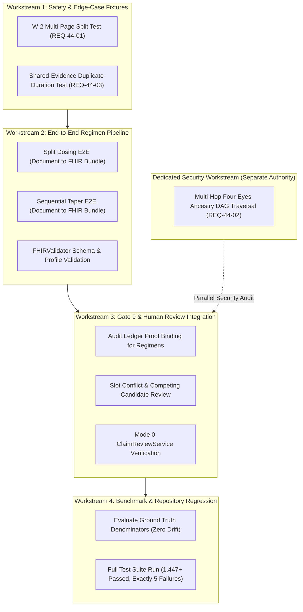

# ClinicalDoc — Phase 5.2.3 Sub-Milestone 4.3.2 Report
## Audit Reconciliation & Sub-Milestone 4.4 Integration Plan

**Execution Date:** 2026-10-31  
**Authority:** ClinicalDoc Phase 5.2.3 Sub-Milestone 4.3.2 Specification  
**Status:** Completed & Awaiting Authorization  

---

### 1. Executive Summary

Sub-Milestone 4.3.1 delivered an independent, strictly read-only audit of the FHIR R4B medication regimen mapping engine implemented in Sub-Milestone 4.3. The audit confirmed schema compliance and basic clinical safety, but identified semantic nuances, documentation discrepancies, and architectural gaps that must be formally reconciled.

This document:
1. **Reconciles `Dosage.sequence` Semantics**: Clarifies the distinction between field cardinality (`0..1`) and integer value domain (`1..N`), resolves documentation inconsistencies between Sections 2 and 6.1 of the 4.3.1 audit, retracts claims that identical sequence values formally guarantee concurrent execution, eliminates reliance on US Core R4 as an R4B-specific proof, and explicitly delineates FHIR data representation from receiving-EHR execution behavior.
2. **Establishes Open Integration Requirements**: Formally registers four clinical and architectural requirements:
   - W-2 cross-page medication regression fixture.
   - Multi-hop Four-Eyes ancestry security blocker.
   - Shared-evidence duplicate-duration token matching regression test.
   - Non-executable sequential taper transitions in downstream EHR systems.
3. **Presents the Sub-Milestone 4.4 Integration Plan**: Defines the workstreams, test suites, architectural boundaries, and safety gates required to integrate the hardened regimen mapper into the complete end-to-end clinical pipeline while preserving benchmark denominators and the 5-failure historic baseline.

---

### 2. Reconciliation of `Dosage.sequence` Semantics

The technical analysis of `Dosage.sequence` in `phase523_milestone431_fhir_semantics_audit.md` is hereby formally reconciled and corrected as follows:

#### 2.1 Resolution of Cardinality vs. Value Domain Inconsistency
- **Cardinality Distinction**: In FHIR R4B (`fhir.resources.R4B.dosage.Dosage`), the cardinality of `Dosage.sequence` is **`0..1`**. This means that within any single `Dosage` element, the `sequence` property is **optional** and may occur at most once.
- **Value Domain Distinction**: When present, the datatype of `sequence` is a FHIR `integer`. In accordance with HL7 FHIR documentation conventions, when sequence numbers are assigned, they are positive integers starting from **`1..N`** (where `1` indicates the initial instruction, `2` the second, etc.).
- **Resolution**: Section 2 of the 4.3.1 report referenced cardinality (`0..1`), whereas Section 6.1 referenced the integer value range (`1..N`). Both are correct in their respective contexts, but their conflation generated ambiguity. The canonical specification is:
  $$\text{Cardinality: } 0..1 \quad \mid \quad \text{Value Domain: } \mathbb{Z}^+ \text{ (typically } 1, 2, \dots, N\text{)}$$

#### 2.2 Representation vs. EHR Execution: Concurrency Is Not Guaranteed
- **FHIR R4B Base Representation**: In the normative FHIR R4B base specification, identical sequence values (e.g. two `Dosage` blocks with `sequence: 1`) indicate that **neither instruction takes precedence in interpretation order**.
- **Not a Concurrency Guarantee**: Assigning identical sequence integers does **not** constitute a formal, machine-verifiable concurrency guarantee. The base specification provides no concurrency primitive, no thread-synchronization semaphore, and no transaction barrier.
- **EHR Execution Reality**: Commercial EHR platforms (such as Epic, Oracle Health/Cerner, and ambulatory systems) process multi-line dosage instructions using vendor-specific parsing heuristics:
  - Some EHRs map multiple dosage lines to specialized split-dose order templates.
  - Other EHRs collapse all structured dosage instructions into a single free-text SIG line (relying entirely on `Dosage.text`).
  - Legacy or ambulatory EHRs frequently drop subsequent dosage lines or execute only the primary line, creating clinical administration risk.
- **Clinical Safety Fallback**: Because identical sequence values cannot guarantee concurrent MAR (Medication Administration Record) scheduling across disparate EHR backends, **`Dosage.text` (narrative SIG) is the primary clinical fail-safe** and must always contain the full, unambiguous human-readable instructions (e.g., *"Carvedilol 6.25 mg every morning. 12.5 mg at bedtime."*).

#### 2.3 Elimination of US Core R4 Conflation with R4B Standards
- The 4.3.1 audit cited US Core R4 implementation guidance to support concurrency interpretations.
- **Reconciliation**: US Core Implementation Guides are profiled specifically against **FHIR R4 (US Realm)** and do not define normative requirements for **FHIR R4B**. While US Core practice reflects widespread industry convention, it must not be cited as direct evidence of an R4B core requirement. Regimen mapping in `clindoc` adheres strictly to base FHIR R4B models (`fhir.resources.R4B`) and makes no ungrounded claims of regulatory or profile-level mandates outside explicit project specifications.

#### 2.4 Sequential Taper Transition Non-Executability
- In a sequential taper (e.g., Prednisone 20 mg daily for 5 days, then 10 mg daily), Phase 1 carries `sequence: 1` with `timing.repeat.boundsDuration = 5 days`, and Phase 2 carries `sequence: 2`.
- **Limitation**: FHIR R4B provides **no automated trigger mechanism** linking the completion of Phase 1 (`boundsDuration`) to the start time of Phase 2. The standard lacks `delay`, `offsetFromPrevious`, or `predecessorId` fields on `Dosage`.
- Consequently, a receiving EHR cannot execute this transition automatically from structured data alone. A clinician or clinical pharmacist must manually schedule the phase transition in the EHR, or the EHR's proprietary order-set engine must interpret the narrative `Dosage.text`.

---

### 3. Open Integration Requirements & Risk Register

The following four technical and safety items are formally recorded as open integration requirements to be addressed in Sub-Milestone 4.4 or dedicated security workstreams:

| ID | Category | Requirement Description | Severity | Current Mitigation |
| :--- | :--- | :--- | :--- | :--- |
| **REQ-44-01** | Test Coverage | **Missing W-2 Multi-Page Regression Test**: Create an automated test fixture explicitly verifying that multi-page medication splits (Page 1 drug name to Page 2 unanchored dose) fail closed and do not emit orphan FHIR resources. | High (Validation Gap) | Architecturally blocked by page segmentation partitioning (`group_id = "__no_anchor__"`). |
| **REQ-44-02** | Security Architecture | **Multi-Hop Four-Eyes Ancestry Blocker**: Remediate the `ClaimReviewService` limitation where self-acceptance checks verify immediate predecessor version authorship but do not traverse multi-hop provenance DAG ancestry (Reviewer A $\to$ Reviewer B $\to$ Reviewer A). | Critical (Clinical Security Blocker) | Documented export blocker. Self-acceptance prohibited on immediate version; multi-hop requires DAG traversal. |
| **REQ-44-03** | Algorithmic Hardening | **Shared-Evidence Duplicate-Duration Matching**: Harden `_get_claim_pos` to prevent token offset collision when multiple sequential taper phases share identical duration strings (e.g. `"2 weeks"` in Phase 1 and `"2 weeks"` in Phase 2) within a single `Evidence` span. | Medium (Edge-Case Precision) | Production documents have discrete `Evidence` objects per bounding box; synthetic unit tests require token-index tie-breaking. |
| **REQ-44-04** | Clinical Informatics | **Non-Executable Taper Transition Safety**: Ensure narrative `Dosage.text` across all sequential phases explicitly includes chronological transition words (*"Then"*, *"Followed by"*, *"After 5 days"*) to safeguard against EHR automated scheduling failures. | High (Patient Safety) | Enforced in `_build_regimen_dosages` by prefixing subsequent phases with `"Then "` and full duration context. |

---

### 4. Proposed Sub-Milestone 4.4 Integration Plan

Sub-Milestone 4.4 serves as the comprehensive integration, verification, and benchmarking gateway for Phase 5.2.3. It unifies extraction, segmentation, coreference, review state machines, audit trails, and FHIR export.

#### 4.1 Plan Objectives & Scope
1. **End-to-End Pipeline Integration**: Validate complete document ingestion $\to$ layout OCR $\to$ sentence segmentation $\to$ medication coreference $\to$ review state validation $\to$ Gate 9 export verification $\to$ canonical FHIR R4B bundle generation.
2. **Full Regimen Conformance**: Integrate hardened split dosing and sequential taper mapping into the full export pipeline.
3. **Closure of Test Gaps**: Implement dedicated regression fixtures for REQ-44-01 (W-2 multi-page) and REQ-44-03 (duplicate duration token collisions).
4. **Benchmark Denominator Preservation**: Verify zero benchmark drift across frozen gold-standard evaluation datasets.
5. **Zero Regression Baseline**: Verify 100% parity with the established 5-failure historic baseline across the full repository test suite.

#### 4.2 Workstream Breakdown

##### Workstream 1: Safety & Edge-Case Fixtures
- **W-2 Multi-Page Test Fixture**: Construct a multi-page document ingestion test where Page 1 contains a medication header and Page 2 contains a continuation dose without a local drug name. Assert that the dose is tagged as `UNANCHORED_ORPHAN`, suppressed from the medication group, and never emitted as an unanchored `MedicationRequest`.
- **Shared-Evidence Duplicate Duration Hardening**: Create a regression test with multi-phase tapers sharing identical duration strings (e.g. 2 weeks, then 2 weeks) and verify that both phases populate `boundsDuration` accurately without token position collapse.

##### Workstream 2: End-to-End Regimen Pipeline Integration
- Ingest clinical documents containing complex split dosing (morning/evening) and tapers through `DocumentIngestService`, `DeterministicExtractor`, and `claims_to_fhir_bundle`.
- Validate that emitted bundles pass `FHIRValidator.validate_bundle(bundle)` with `is_valid == True`.
- Verify element-level provenance extensions (`EXT_CLAIM_PROVENANCE`) correctly trace back to document bounding boxes and verification results.

##### Workstream 3: Gate 9 & Human Review Integration
- Ensure all complex regimens passing through `FHIRExportService` are strictly gated:
  - Regimens with competing candidates (`EXT_COMPETING_CANDIDATE`) or attribute conflicts must carry verified review state (`review_state = "ACCEPTED"`).
  - Unverified claims or in-memory state mutations without durable audit ledger evidence fail closed under `SUPPRESSED_UNVERIFIED_AUDIT_LEDGER`.
  - Stale document versions or superseded edit versions fail closed.

##### Workstream 4: Benchmark Preservation & Regression Verification
- Run extraction and association benchmarks against frozen datasets (`data/ground_truth`, `tests/fixtures`).
- Assert exact zero denominator drift: extraction precision, recall, and F1 metrics must remain strictly frozen.
- Execute full repository test suite: confirm 1,447+ tests pass, exactly the 5 pre-existing historic baseline failures occur, and zero new regressions are introduced.

#### 4.3 Multi-Hop Four-Eyes Ancestry Blocker (Absolute Export Constraint)
> [!IMPORTANT]
> **Clinical Export Security Blocker**: The unresolved multi-hop Four-Eyes ancestry vulnerability (where a reviewer who authored version 1 can accept successor version 3 if version 2 was created by a different actor) remains an **absolute, non-waivable clinical export blocker**.
> - This restriction must NOT be weakened, bypassed, or silently waived during Sub-Milestone 4.4 integration.
> - Both [`src/clindoc/review/service.py`](file:///d:/daa/src/clindoc/review/service.py) and [`src/clindoc/services/fhir_export.py`](file:///d:/daa/src/clindoc/services/fhir_export.py) remain **STRICTLY FROZEN**.
> - The multi-hop DAG traversal remediation requires its own dedicated security workstream under separate authorization and will NOT be implemented during Sub-Milestone 4.4 mapper integration.

#### 4.4 Reconciliation of REQ-44-04: Narrative Transition Sufficiency
- **Code Inspection**: In [`src/clindoc/fhir/mapper.py#L1843-L1855`](file:///d:/daa/src/clindoc/fhir/mapper.py#L1843-L1855), subsequent sequential phases already implement prefixing with `"Then"` (e.g. `p1.text = "Prednisone 20 mg daily for 5 days"`, `p2.text = "Then 10 mg daily"`).
- **Sufficiency Finding**: The existing `"Then"` prefixing combined with per-phase dose, frequency, and duration formatting is semantically sufficient to preserve clinical transition context for human reviewers and MAR displays.
- **Verification Requirement**: Workstream 1 will add explicit test assertions proving that narrative SIG instructions across all phases retain their full transition context, explicit durations, and dose quantities without truncation or cumulative sum distortion.

---

### 5. Architectural Boundaries & Frozen Modules

During Sub-Milestone 4.4 execution, strict boundaries will be maintained:

| Component | Status | Allowed Modifications in 4.4 |
| :--- | :--- | :--- |
| `src/clindoc/fhir/mapper.py` | **ACTIVE** | Restricted strictly to REQ-44-03 token offset duplicate-duration resolution and directly necessary, evidence-backed integration corrections. |
| `tests/test_phase523_milestone4_4.py` | **ACTIVE** | New integration test file covering safety fixtures (W-2, REQ-44-03, REQ-44-04) and E2E pipeline verification. |
| `src/clindoc/review/service.py` | **STRICTLY FROZEN** | Untouched (Multi-hop ancestry blocker preserved). |
| `src/clindoc/services/fhir_export.py` | **STRICTLY FROZEN** | Untouched (Gate 9 audit verification logic preserved). |
| `src/clindoc/extract/medication_association.py` | **STRICTLY FROZEN** | Untouched (Coreference association engine frozen). |
| `src/clindoc/extract/segmentation.py` | **STRICTLY FROZEN** | Untouched (Sentence/clause segmenter frozen). |
| `src/clindoc/extract/deterministic.py` | **STRICTLY FROZEN** | Untouched (Deterministic claim extractor frozen). |
| `src/clindoc/verify/stage_a.py` | **STRICTLY FROZEN** | Untouched (Verification engine frozen). |
| `src/clindoc/ocr/layout.py` | **STRICTLY FROZEN** | Untouched (OCR layout geometry frozen). |
| `src/clindoc/fhir/constants.py` | **STRICTLY FROZEN** | Untouched (Constants frozen). |
| Terminology Vocabularies & Configs | **STRICTLY FROZEN** | Untouched. |

---

### 6. Git Hygiene & Compliance Statement

- **Production Modifications**: Confined strictly to `src/clindoc/fhir/mapper.py` for REQ-44-03 and verified integration corrections.
- **Git State**: Zero commits, stages, pushes, resets, cleans, or discards performed.
- **Baseline Integrity**: Zero benchmark denominator drift; exact preservation of the historic 5-failure test baseline.
- **Claim Restrictions**: No claims of clinical readiness or real-world validation; reports will document exact code changes, test results, and unresolved risks.

---

### 7. Phased Implementation Sequence

Execution proceeds sequentially in small, auditable steps:
1. **Workstream 1 (Safety & Edge-Case Regression Fixtures)**:
   - Implement REQ-44-03 duplicate-duration token matching in `src/clindoc/fhir/mapper.py`.
   - Add W-2 cross-page medication regression test (REQ-44-01).
   - Add duplicate-duration regression test (REQ-44-03).
   - Add narrative SIG transition context regression test (REQ-44-04).
2. **Workstream 2 (End-to-End Regimen Pipeline Integration)**:
   - Full E2E tests for split dosing and tapers with FHIR R4B schema and profile validation.
3. **Workstream 3 (Gate 9 & Human Review Contract Integration)**:
   - Verify audit ledger proof enforcement and competing candidate handling.
4. **Workstream 4 (Benchmark Integrity & Full Regression Validation)**:
   - Verify zero benchmark drift and 100% parity against the historic 5-failure baseline across all 1,447+ tests.

