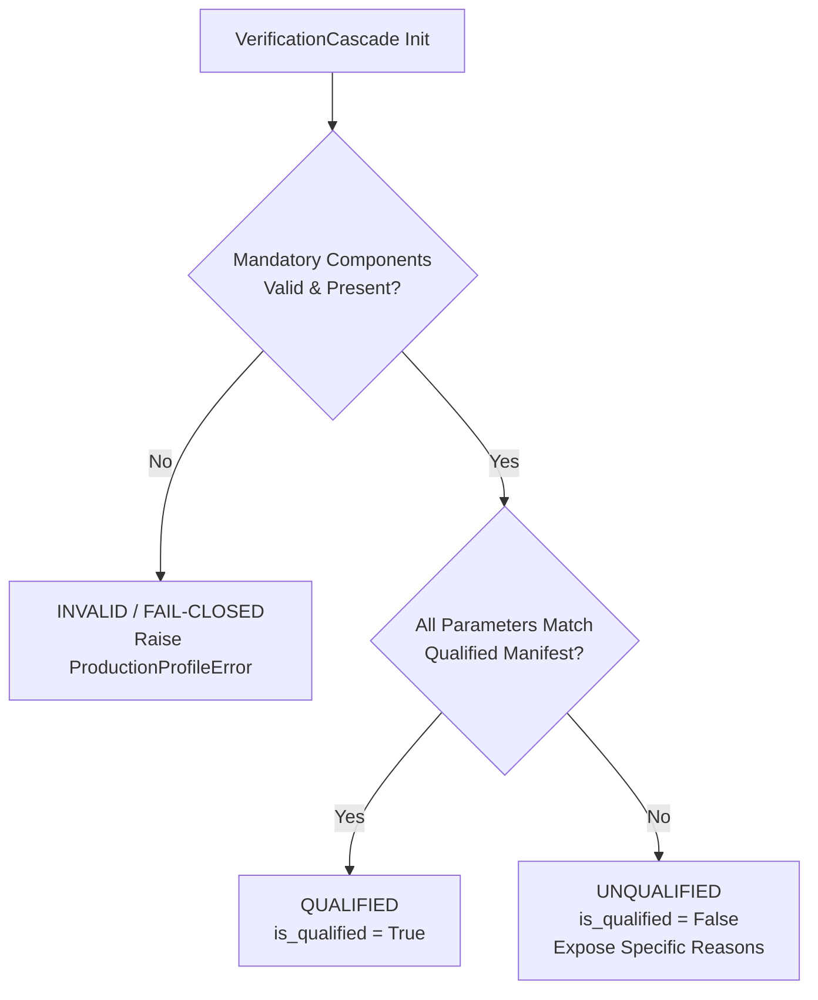

# Phase 8.2 Task 3: Qualified Configuration Manifest Implementation Report

**Status:** COMPLETE  
**Phase:** 8.2 Pipeline Hardening & Production Containment  
**Task:** 3 — Qualified Configuration Manifest (PD-005, PD-018, PD-019)  
**Date:** 2026-10-04  
**Git Commit / Reference:** `9056df7579adc0a9cae1a2f7fb2b79db34378053` (HEAD)  

---

## 1. Executive Summary

In accordance with [PRODUCTIZATION_SPEC.md §3.6, §3.8, §10, §13](file:///d:/daa/PRODUCTIZATION_SPEC.md) and [PRODUCTIZATION_DECISIONS.md PD-005](file:///d:/daa/PRODUCTIZATION_DECISIONS.md), we have implemented the cryptographically anchored **Qualified Configuration Manifest** interface in [src/clindoc/manifest.py](file:///d:/daa/src/clindoc/manifest.py) and integrated it with [src/clindoc/verify/cascade.py](file:///d:/daa/src/clindoc/verify/cascade.py) and [src/clindoc/config.py](file:///d:/daa/src/clindoc/config.py).

The manifest guarantees that clinical verification claims (e.g., V8 OOD accuracy 97.48%, Stage B autonomous coverage 79.13% at risk 0.0069) are strictly tied to the exact audited production configuration. Any divergence in weights, calibration temperatures, escalation thresholds, model identifiers, or prompt templates is explicitly detected and flagged as `UNQUALIFIED`, while missing, uncalibrated, or unsafe components fail closed (`INVALID`).

---

## 2. Pinned Canonical Manifest Specification (`v1.0.0`)

The canonical V1 manifest ([QUALIFIED_MANIFEST_DICT_V1](file:///d:/daa/src/clindoc/manifest.py)) pins every parameter governing audited production inference:

| Component | Pinned Field | Audited Value | Role / Authority | Status / Artifact |
| :--- | :--- | :--- | :--- | :--- |
| **Manifest Metadata** | `manifest_version` | `"1.0.0"` | Manifest schema version | Pinned |
| **Source Tracking** | `git_commit` | `9056df7579adc0a9cae1a2f7fb2b79db34378053` | Frozen code state | Verified |
| **Execution Profile** | `profile` | `"production"` | Fail-closed profile requirement | Enforced |
| **ModernBERT Checkpoint** | `checkpoint_path` | `data/m2_results_v3/checkpoints/modernbert_text_only_v3_fold0_seed42.pt` | Stage B weights | Verified local file |
| **ModernBERT Hash** | `checkpoint_sha256` | `d24add6135634f660d2fdcf1c51545e201cc65c00fd2d060452eac95be9e7902` | SHA-256 weight integrity | Pinned & checked |
| **ModernBERT Architecture** | `model_id` | `thomas-sounack/BioClinical-ModernBERT-base` | Backbone model ID | Pinned |
| **ModernBERT Features** | `aux_mode` | `"none"` | Text-only claim/evidence input | Pinned |
| **ModernBERT Context** | `max_length` | `256` | Tokenizer max length | Pinned |
| **ModernBERT Temperature** | `temperature` | `1.146522` | Post-hoc scaling ($T = 1.146522$) | Pinned ($\pm 10^{-5}$) |
| **Stage B Threshold** | `escalation_threshold` | `0.60` | Stage B $\rightarrow$ C escalation | Pinned ($\pm 10^{-4}$) |
| **Stage B Autonomous** | `autonomous_threshold`| `0.85` | Dual-gate selective acceptance | Pinned (V12) |
| **Stage A Numeric** | `numeric_tolerance` | `0.0001` | Floating point exact check | Pinned |
| **Stage A Negation** | `negation_patterns_count` | `11` | Compiled negation patterns | Pinned |
| **Stage C LLM Model** | `model_id` | `Qwen/Qwen2.5-7B-Instruct-AWQ` | 4-bit quantized AWQ on vLLM | Pinned |
| **Stage C Revision** | `revision_hash` | `None` (UNRESOLVED) | Upstream HuggingFace commit hash | *Documented limitation* |
| **Stage C Quantization**| `quantization` | `"AWQ_4BIT"` | vLLM execution profile | Pinned |
| **Stage C Serving** | `serving_engine` | `"vLLM"` | OpenAI-compatible server | Pinned |
| **Stage C Decoding** | `temperature` / `seed` | `0.0` / `42` (`max_tokens=256`) | Greedy deterministic decoding | Pinned |
| **Stage C Prompt Version**| `prompt_version` | `"V8_STAGE_C_LABFLAG_PROMPT_V1"` | Tabular precedence prompt | Pinned |
| **Stage C Prompt Hash** | `prompt_text_sha256` | `dcd6be9c502ec0b05a7858a438d67d929de792987d57ac7f52d0d0c21f868ae3` | SHA-256 of in-code prompt | Computed & checked |
| **Stage C Prompt File** | `prompt_artifact_path`| `None` (UNRESOLVED) | Tracked standalone prompt file | *Documented limitation* |

---

## 3. Cryptographic Integrity & Digest Protection

To prevent silent tampering with manifest definitions, the manifest uses canonical serialization:
1. All manifest keys and nested dictionaries are sorted recursively.
2. Canonical JSON string is formatted with no extra whitespace: `json.dumps(dict, sort_keys=True, separators=(',', ':'), ensure_ascii=True)`.
3. SHA-256 digest is generated over the canonical UTF-8 bytes:
   $$\text{Manifest Digest} = \text{SHA256}(\text{CanonicalJSON})$$
4. **Canonical V1 Manifest Digest:**
   ```text
   7a5cb9f4d471b91704aafd00bd391b7ec14564cb99c2ffe52d54e87ea6d15b53
   ```
5. `QualifiedManifest.verify_integrity()` verifies this digest at load time. Any modification to weights, thresholds, or model names without an approved re-digesting raises `ProductionProfileError`.

---

## 4. Operational State Triad

The system enforces three unambiguous states:



- **QUALIFIED:**
  - Runtime profile is `PRODUCTION`.
  - ModernBERT checkpoint file exists, passes safe loading, and matches SHA-256 `d24add61...`.
  - Temperature scaler is fitted with $T = 1.146522$.
  - Escalation threshold equals $0.60$.
  - Stage C judge is `VLLMJudgeClient` targeting `Qwen/Qwen2.5-7B-Instruct-AWQ`.
  - Stage C prompt version is `V8_STAGE_C_LABFLAG_PROMPT_V1` and prompt text SHA-256 matches `dcd6be9c...`.
- **UNQUALIFIED:**
  - System executes without crashing, but configuration differs from the audited configuration (e.g., development profile, altered temperature $T=1.0$, threshold $0.75$, missing `-AWQ` suffix, or modified prompt text).
  - Explicitly exposed via `cascade.is_qualified == False`, `cascade.qualification_status == QualificationStatus.UNQUALIFIED`, and `cascade.qualification_report.reasons`.
- **INVALID / FAIL-CLOSED:**
  - Mandatory production requirement missing or unsafe (e.g. non-existent checkpoint file, `allow_heuristics=True` in production, `DefaultMockLLMJudge` in production, corrupted pickle file, or missing manifest mandatory key).
  - Fails closed immediately by raising `ProductionProfileError`.

---

## 5. Documented Limitations & Unresolved Values

Per the user requirements, no values were guessed or invented:

1. **Qwen Revision Hash (`CANONICAL_QWEN_REVISION_HASH = None`):**
   - *Status:* UNRESOLVED.
   - *Reason:* Phase 4 audited evaluations were performed via an external vLLM instance running on a remote Colab instance (`Qwen/Qwen2.5-7B-Instruct-AWQ`). The specific 40-character Git commit hash of the upstream HuggingFace repository was not recorded in `phase4_cascade_eval_report.json` or `V1_EXPERIMENT_FREEZE.md`.
   - *Action:* The field is explicitly tracked as `None` in the manifest and must be pinned during production container image packaging.

2. **Stage C Tracked Prompt File (`CANONICAL_STAGE_C_PROMPT_ARTIFACT_PATH = None`):**
   - *Status:* UNRESOLVED.
   - *Reason:* The authoritative prompt text is defined as string constants (`DEFAULT_STAGE_C_SYSTEM_PROMPT` and `LAB_FLAG_TABULAR_INSTRUCTION`) inside `src/clindoc/verify/stage_c.py` rather than as an external `.jinja` or `.txt` template file.
   - *Action:* The prompt text itself is cryptographically hashed (`dcd6be9c502ec0b05a7858a438d67d929de792987d57ac7f52d0d0c21f868ae3`) and validated at runtime, while the file path is explicitly marked as `None`.

---

## 6. Verification and Regression Testing

A test suite comprising 12 focused tests was authored in [tests/test_qualified_manifest.py](file:///d:/daa/tests/test_qualified_manifest.py):

| Test Case | Scenario Evaluated | Expected Verdict | Result |
| :--- | :--- | :--- | :--- |
| `test_exact_qualified_configuration_is_qualified` | Canonical production cascade | `QUALIFIED` (`is_qualified=True`) | **PASSED** |
| `test_production_pipeline_config_evaluates_qualified` | Canonical `ProductionPipelineConfig` | `QUALIFIED` (`is_qualified=True`) | **PASSED** |
| `test_wrong_checkpoint_hash_evaluates_unqualified` | Altered checkpoint SHA-256 | `UNQUALIFIED` (checkpoint mismatch) | **PASSED** |
| `test_wrong_calibration_temperature_evaluates_unqualified`| Modified temperature ($T=1.0$) | `UNQUALIFIED` (temperature mismatch) | **PASSED** |
| `test_wrong_stage_b_escalation_threshold_evaluates_unqualified`| Modified threshold ($\tau=0.75$) | `UNQUALIFIED` (threshold mismatch) | **PASSED** |
| `test_wrong_qwen_model_identifier_evaluates_unqualified` | Missing `-AWQ` suffix | `UNQUALIFIED` (model name mismatch) | **PASSED** |
| `test_wrong_prompt_version_evaluates_unqualified` | Divergent prompt version string | `UNQUALIFIED` (prompt version mismatch) | **PASSED** |
| `test_tampered_prompt_text_hash_evaluates_unqualified` | Tampered prompt text bytes | `UNQUALIFIED` (prompt SHA-256 mismatch) | **PASSED** |
| `test_missing_mandatory_manifest_component_fails_closed` | Missing top-level or section key | `ProductionProfileError` (fail closed) | **PASSED** |
| `test_dev_profile_evaluates_unqualified` | `profile=RuntimeProfile.DEV` | `UNQUALIFIED` (dev profile) | **PASSED** |
| `test_manifest_integrity_mismatch_detected` | Tampered manifest dict vs digest | `ProductionProfileError` (fail closed) | **PASSED** |
| `test_canonical_manifest_digest_computation_deterministic` | Deterministic JSON digest | Exact digest match | **PASSED** |

### Regression Suite Results
The full regression suite encompassing runtime profiles, safe checkpoint loading, verification cascade, Stage C judge, and qualified manifest passed cleanly:
```text
83 passed, 1 warning in 34.31s
```
*(Warning: standard PyTorch pickle protocol 3 note during synthetic checkpoint mocking).*
